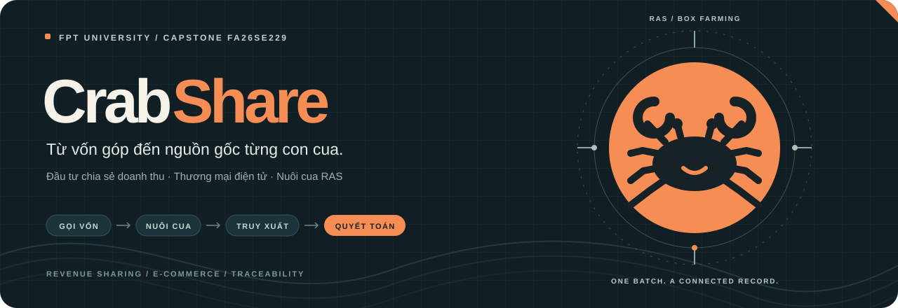
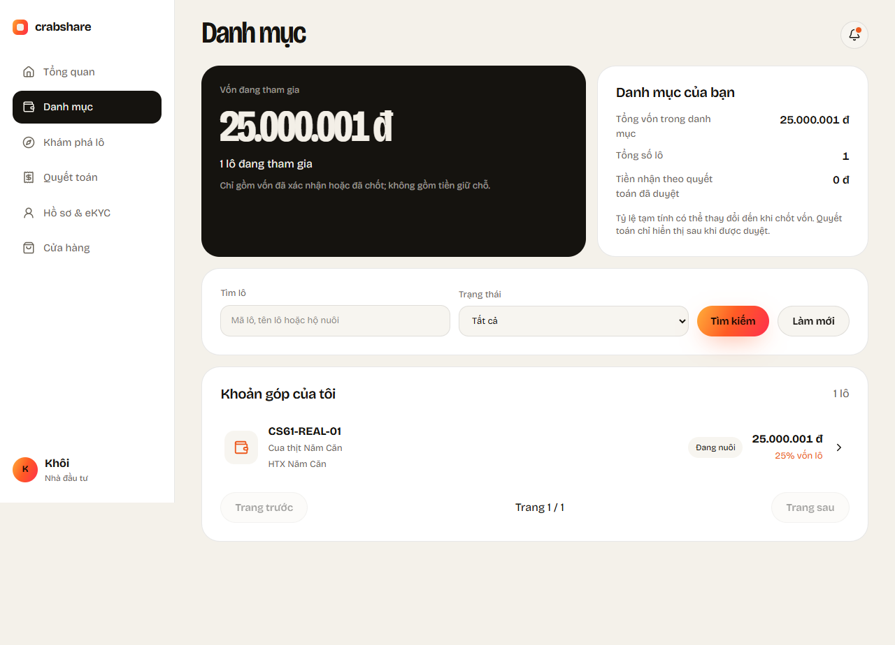
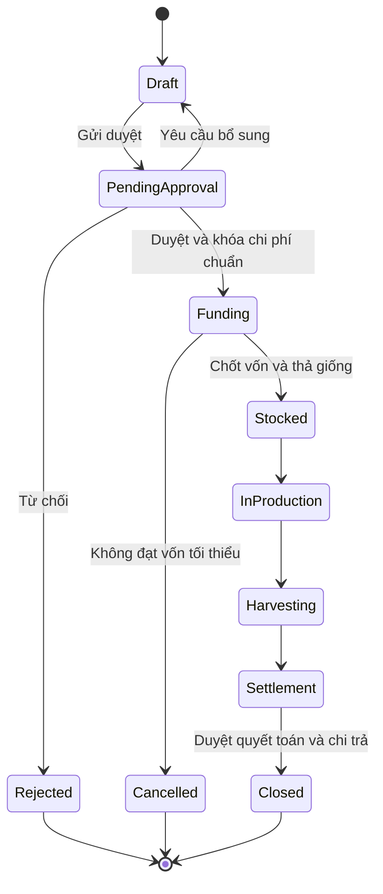
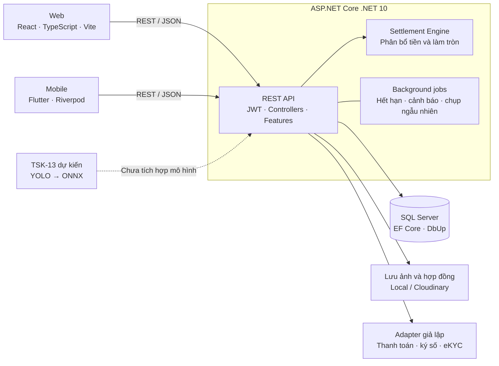

<div align="center">



<h1>CrabShare</h1>

<p><strong>Gọi vốn · Theo dõi nuôi · Truy xuất · Bán hàng · Quyết toán</strong></p>

<p>Nền tảng đầu tư chia sẻ doanh thu kết hợp thương mại điện tử<br>cho mô hình nuôi cua trong hệ thống tuần hoàn nước RAS.</p>

<p>
  <a href="https://github.com/thienhoibai/crabshare/actions/workflows/ci.yml"></a>
  
  
  
</p>

<p>
  
  
  
  
  
</p>

<p>
  <a href="#tong-quan">Tổng quan</a> ·
  <a href="#tinh-nang">Tính năng</a> ·
  <a href="#kien-truc">Kiến trúc</a> ·
  <a href="#bat-dau">Bắt đầu</a> ·
  <a href="#kiem-thu">Kiểm thử</a> ·
  <a href="#tai-lieu">Tài liệu</a> ·
  <a href="#doi-ngu">Đội ngũ</a>
</p>

<p>
  <a href="https://crabshare.vercel.app">Demo web</a> ·
  <a href="https://github.com/thienhoibai/crabshare/actions">GitHub Actions</a> ·
  <a href="https://nguyendaothien2003.atlassian.net/jira/software/projects/CS/boards/2/backlog">Jira</a>
</p>

</div>

<a name="tong-quan"></a>

## ✨ Tổng quan

**CrabShare kết nối nhà đầu tư, hộ nuôi và người mua trong cùng một vòng đời lô nuôi:** từ phê duyệt chi phí, huy động vốn, ký hợp đồng đến ghi nhận sản xuất, thu hoạch, bán hàng và quyết toán. Mỗi con cua được theo dõi qua hộp nuôi có số định danh và tem truy xuất khi thu hoạch.

Trong mô hình RAS (*Recirculating Aquaculture System*), nước được xử lý và tuần hoàn; mỗi con cua được nuôi trong một hộp riêng. CrabShare tổ chức dữ liệu và giao dịch xoay quanh **Batch — lô nuôi**, giúp nhà đầu tư theo dõi vốn, hộ nuôi quản lý vận hành và người mua xem nguồn gốc sản phẩm.

| Vấn đề | Cách CrabShare tiếp cận |
|---|---|
| Tranh chấp chi phí sau thu hoạch | Phê duyệt và khóa **Standard Cost** trước khi mở gọi vốn, gồm dự phòng hao hụt |
| Thiếu thông tin về quá trình nuôi | Nhật ký theo lô, sự kiện từng hộp, ảnh bằng chứng, cảnh báo và hàng đợi thẩm định |
| Doanh thu chỉ do hộ nuôi tự khai | Tổng hợp doanh thu thực thu từ đơn hàng hoàn tất trong hệ thống |
| Đầu tư, bao tiêu và mua hàng rời rạc | Liên kết góp vốn, hợp đồng, tồn kho, đơn hàng, tem cua và bảng quyết toán |

**Thông tin đề tài:** FA26SE229 · Chuyên ngành Kỹ thuật phần mềm · Thời gian 09–12/2026. Phạm vi nghiệp vụ tham chiếu **Phiếu đăng ký đề tài v1.2, sửa đổi ngày 11/10/2026**.

<details>
<summary><strong>Xem tên đề tài đầy đủ</strong></summary>

- **Tiếng Việt:** CrabShare — Nền tảng đầu tư chia sẻ doanh thu kết hợp thương mại điện tử cho mô hình nuôi cua trong hệ thống RAS.
- **English:** CrabShare — A Revenue-Sharing Investment and E-Commerce Platform for Crab Farming in Recirculating Aquaculture Systems.

</details>

### Giao diện thực tế



*Màn hình danh mục nhà đầu tư từ bộ ảnh kiểm thử trong repository; số liệu trong ảnh là dữ liệu kiểm thử.*

<a name="tinh-nang"></a>

## 🚀 Tính năng và phạm vi triển khai

### Ai sử dụng CrabShare?

| Vai trò | Công việc chính |
|---|---|
| **Nhà đầu tư tài chính** | Xác minh danh tính, xem điều khoản và chi phí chuẩn, góp vốn, ký hợp đồng, theo dõi bằng chứng và xem sao kê quyết toán |
| **Nhà đầu tư bao tiêu** | Có chức năng nhà đầu tư; thêm cam kết sản lượng, giá và quyền mua trong cửa sổ ưu tiên |
| **Chủ hộ nuôi / nhân viên** | Quản lý hộp và lô, ghi nhật ký, chụp bằng chứng, xử lý cảnh báo, thu hoạch, gắn tem, đóng gói và cập nhật giao hàng |
| **Khách hàng** | Xem sản phẩm, mua hàng hoặc đặt trước có cọc, theo dõi đơn, đổi trả, khiếu nại, đánh giá và quét tem truy xuất |
| **Quản trị nền tảng** | Duyệt hộ nuôi và lô, giám sát dòng tiền, duyệt quyết toán, xử lý tranh chấp, xem báo cáo và nhật ký kiểm toán |
| **Người thẩm định bằng chứng** | Xem ảnh bị gắn cờ và đưa ra kết luận trong phạm vi được cấp quyền; không thẩm định lô mình đã đầu tư |

### Các phân hệ

Bảng dưới mô tả mã nguồn hiện có. Các mục tiêu nghiên cứu và tiêu chí nghiệm thu được trình bày riêng ở phần [kiểm thử](#kiem-thu).

| Phân hệ | Chức năng trong repository |
|---|---|
| **Tài khoản và danh tính** | JWT, phân quyền theo vai trò và hộ nuôi/lô, quy trình KYC, tài khoản nhận tiền, địa chỉ khách hàng |
| **Hộ nuôi, hộp và lô** | Đăng ký/duyệt hộ nuôi, đánh số và phân bổ hộp, tạo/duyệt lô, quản lý phiên bản chi phí chuẩn |
| **Gọi vốn và hợp đồng** | Giữ chỗ góp vốn, yêu cầu VietQR, đối soát, hết hạn/hoàn tiền, hợp đồng từ mẫu và luồng ký theo thứ tự |
| **Sản xuất và cảnh báo** | Thả giống, nhật ký môi trường/thức ăn, sự kiện lột xác/chết/thả bù, timeline, cảnh báo và leo thang |
| **Bằng chứng và thẩm định** | Chụp ảnh trực tiếp trên app, vị trí và thời gian, SHA-256/dHash, yêu cầu chụp ngẫu nhiên, điểm rủi ro, giải trình và duyệt ảnh |
| **Thu hoạch và truy xuất** | Cân/phân hạng từng con, sinh tem, xác nhận kích hoạt bằng ảnh, quét tem và truy xuất công khai |
| **Cửa hàng và đơn hàng** | Niêm yết, giỏ hàng/checkout, giữ tồn, đặt trước có cọc, bao tiêu, đóng gói bằng quét tem, giao hàng, đổi trả, khiếu nại và đánh giá |
| **Quyết toán và chi trả** | Tổng hợp doanh thu, tính Revenue Pool, phân bổ theo vốn, góp ý trong hạn, phê duyệt và tạo lệnh chi |
| **Danh mục và quản trị** | Danh mục nhà đầu tư, thông báo, dashboard theo vai trò, báo cáo và audit log |

### Trạng thái tích hợp

| Hạng mục | Trạng thái hiện tại |
|---|---|
| Web và mobile | Nhiều luồng đã gọi API thực, gồm danh mục, nhật ký, bằng chứng, thu hoạch và truy xuất; chưa coi toàn bộ giao diện là đã hoàn tất |
| Thanh toán, ký số, eKYC | Đang đăng ký `FakePaymentGateway`, `FakeSigningService`, `FakeEkycProvider`; phục vụ phát triển và demo |
| Lưu tệp | Có `LocalFileStorage` và `CloudinaryFileStorage`, chọn bằng cấu hình |
| Nhận diện cua — TSK-13 | Đang dùng `NoopCrabDetector`, trả về **chưa có kết luận**; `ml/` mới có hướng dẫn, chưa có mô hình ONNX hay kết quả đánh giá |
| Ingestion API | Thuộc phạm vi phiếu v1.2; chưa có endpoint nhập dữ liệu trại được triển khai trong checkout này |
| Một số màn hình phụ | `/san-pham` vẫn dùng trang sản phẩm tĩnh; thao tác gửi hồ sơ pháp lý hộ nuôi và lưu cấu hình quản trị còn là giao diện minh họa; accessor danh sách hộp cũ trên mobile vẫn dùng mock |

**Giới hạn của đề tài:** tích hợp tài khoản production và chuyển tiền thật, vai trò trung gian tài chính được cấp phép, cảm biến/camera/phần cứng máy in, tích hợp riêng từng phần mềm trại, đơn vị vận chuyển, marketplace nhiều nhà bán, bán lại khoản góp vốn và nhận diện cua chết/lột xác/kích thước nằm ngoài phạm vi. Theo thiết kế nghiệp vụ, tiền do trung gian thanh toán giữ; CrabShare ghi nhận, đối soát và phát lệnh.

## 🔄 Vòng đời lô và nguyên tắc quyết toán



### Revenue Pool

```text
Revenue Pool = Doanh thu thực thu từ đơn hoàn tất − Chi phí chuẩn đã khóa
```

- **Pool dương:** tính thù lao người nuôi theo tỷ lệ của lô; phần còn lại chia cho nhà đầu tư theo vốn đã chốt.
- **Pool bằng hoặc nhỏ hơn 0:** không có thù lao người nuôi; phân bổ lỗ theo vốn, mức lỗ mỗi nhà đầu tư tối đa bằng vốn đã góp. Phần lỗ vượt tổng vốn được ghi riêng là `UncoveredLoss`.
- **Làm tròn:** dùng thuật toán *largest remainder*; hòa phần lẻ thì ưu tiên vốn lớn hơn, sau đó mã nhà đầu tư nhỏ hơn, để kết quả xác định và khớp tổng tới **1 VND** trong miền đầu vào được hỗ trợ.
- **Biểu diễn tiền:** số nguyên đồng (`long` ở C#, `DECIMAL(18,0)` ở SQL); tỷ lệ và phép chia dùng `decimal`. Không dùng số thực dấu phẩy động cho tiền và không hiển thị lợi suất kỳ vọng.

Ví dụ minh họa, **không phải cam kết lợi nhuận**: doanh thu 120.000.000đ, chi phí chuẩn 100.000.000đ → Pool 20.000.000đ. Nếu thù lao người nuôi là 10%, còn 18.000.000đ chia theo vốn; hai nhà đầu tư góp theo tỷ lệ 60/40 nhận phần chia 10.800.000đ và 7.200.000đ trước khoản thuế khấu trừ nếu có. Phần chia này được cộng với vốn khi tính số chi trả.

Mã nguồn tính toán nằm trong [`CrabShare.SettlementEngine`](backend/src/CrabShare.SettlementEngine), độc lập với API và CSDL để kiểm thử các quy tắc tài chính.

<a name="kien-truc"></a>

## 🏗️ Kiến trúc và công nghệ

CrabShare là một **monorepo** với API dùng chung cho web và mobile. Backend tổ chức theo **modular monolith**, chia các tính năng thành lát cắt dọc trong `Features/`; database được quản lý bằng script SQL và DbUp.



| Thành phần | Công nghệ chính | Tài liệu |
|---|---|---|
| **Backend** | .NET 10, ASP.NET Core, EF Core 10, JWT Bearer, OpenAPI + Scalar | [`backend/`](backend/README.md) |
| **Web** | React 19, TypeScript 5.8, Vite 6, Tailwind CSS 4, TanStack Query, Zustand, React Router | [`web/`](web/README.md) |
| **Mobile** | Flutter 3.47, Dart, Riverpod, go_router, Dio, secure storage, camera/GPS/QR | [`mobile/`](mobile/README.md) |
| **Database** | SQL Server; SQL-first, DbUp, EF scaffold | [`database/`](database/README.md) |
| **Kiểm thử** | xUnit, FsCheck, Stryker.NET, Playwright, Flutter Test | [Kiểm thử và nghiên cứu](#kiem-thu) |
| **Triển khai** | GitHub Actions, Vercel, Azure App Service + Azure SQL; mẫu Docker/Caddy tùy chọn | [`docs/deploy.md`](docs/deploy.md) |
| **AI dự kiến** | YOLO fine-tuning → ONNX, tích hợp qua `ICrabDetector` | [`ml/`](ml/README.md) |

<details>
<summary><strong>Cấu trúc repository</strong></summary>

```text
crabshare/
├── backend/
│   ├── src/CrabShare.Api/                 # REST API, Features, Infrastructure
│   ├── src/CrabShare.SettlementEngine/    # Logic quyết toán thuần
│   ├── tests/                            # API, database và engine tests
│   └── tools/CrabShare.DbMigrator/        # Chạy SQL migrations
├── web/                                  # Giao diện React
├── mobile/                               # Ứng dụng Flutter
├── database/                             # Migrations và tài liệu tham chiếu
├── ml/                                   # Hướng dẫn phát triển mô hình TSK-13
├── docs/                                 # Kiến trúc, quy ước, kế hoạch, validation
├── deploy/                               # Container, Caddy, smoke checks
├── tools/acceptance/                      # Công cụ kiểm tra nghiệm thu
├── .github/workflows/                     # CI, deploy và phát hành mobile
└── docker-compose.yml                    # SQL Server dùng cho local
```

</details>

<a name="bat-dau"></a>

## ⚡ Bắt đầu trên máy phát triển

### 1. Chuẩn bị

| Công cụ | Yêu cầu |
|---|---|
| Git | Clone và làm việc với repository |
| .NET SDK | **10.x** |
| Node.js | **22.x**, theo cấu hình CI; dùng npm và `package-lock.json` |
| SQL Server | **LocalDB** trên Windows hoặc SQL Server có CSDL riêng; Docker local dùng SQL Server 2022 |
| Flutter | **3.47.7** để khớp CI; Dart theo SDK và ràng buộc trong `pubspec.yaml` |
| Công cụ mobile | Chrome để xem nhanh; Android SDK/emulator hoặc thiết bị để thử camera/GPS/QR |

Visual Studio có workload **ASP.NET and web development** hoặc VS Code + C# Dev Kit đều dùng được cho backend. LocalDB là lựa chọn mặc định của cấu hình Development trên Windows.

Các lệnh dưới dùng **PowerShell**. Bắt đầu từ thư mục muốn lưu dự án:

```powershell
git clone https://github.com/thienhoibai/crabshare.git
Set-Location crabshare
dotnet tool restore --tool-manifest backend/dotnet-tools.json
```

### 2. Tạo CSDL và chạy API

Từ thư mục gốc repository, với LocalDB đã cài:

```powershell
dotnet run --project backend/tools/CrabShare.DbMigrator
dotnet run --project backend/src/CrabShare.Api --launch-profile http
```

Migrator tạo CSDL LocalDB `CrabShareDev` và áp dụng các script `database/migrations/V*.sql` chưa chạy. Ở môi trường Development, khi bật seed và bảng người dùng còn trống, API tạo dữ liệu demo.

| Địa chỉ local | Mục đích |
|---|---|
| [localhost:5233/scalar](http://localhost:5233/scalar) | Xem và thử API; chỉ mở ở Development |
| [localhost:5233/openapi/v1.json](http://localhost:5233/openapi/v1.json) | OpenAPI; chỉ mở ở Development |
| [localhost:5233/api/health/live](http://localhost:5233/api/health/live) | Kiểm tra tiến trình API |
| [localhost:5233/api/health/ready](http://localhost:5233/api/health/ready) | Kiểm tra API và kết nối CSDL |

<details>
<summary><strong>Dùng SQL Server qua Docker thay LocalDB</strong></summary>

Compose ở gốc chỉ chạy SQL Server. Đặt mật khẩu local của bạn rồi khởi động:

```powershell
$env:MSSQL_SA_PASSWORD = '<mat-khau-local-du-manh>'
docker compose up -d sqlserver
```

Chờ SQL Server sẵn sàng, kết nối `localhost,1433` bằng công cụ SQL với tài khoản `sa`, rồi tạo CSDL nếu chưa có:

```sql
IF DB_ID(N'CrabShareDev') IS NULL
    CREATE DATABASE [CrabShareDev];
```

Trong terminal chạy migrator/API, cấu hình cùng chuỗi kết nối:

```powershell
$env:CRABSHARE_DB = "Server=localhost,1433;Database=CrabShareDev;User Id=sa;Password=$env:MSSQL_SA_PASSWORD;TrustServerCertificate=True"
$env:ConnectionStrings__Default = $env:CRABSHARE_DB
dotnet run --project backend/tools/CrabShare.DbMigrator
dotnet run --project backend/src/CrabShare.Api --launch-profile http
```

Migrator chỉ tự tạo database với **LocalDB**; SQL Server Docker/remote cần có database trước. Mật khẩu và cấu hình trên chỉ dùng cho local; hướng dẫn triển khai nằm ở [`docs/deploy.md`](docs/deploy.md).

</details>

### 3. Chạy web

Mở terminal mới tại thư mục gốc:

```powershell
Set-Location web
npm ci
if (!(Test-Path .env.local)) { Copy-Item .env.example .env.local }
npm run dev
```

Mở [localhost:5173](http://localhost:5173). `VITE_API_URL` trong `.env.local` mặc định là `http://localhost:5233`; chỉ cần sửa nếu API chạy ở địa chỉ khác. Nếu đã có `.env.local`, giữ cấu hình hiện tại thay vì chép đè.

### 4. Chạy mobile

Mở terminal mới tại thư mục gốc:

```powershell
Set-Location mobile
flutter pub get
flutter run -d chrome --web-port 8080
```

Mở [localhost:8080](http://localhost:8080) để xem nhanh. Trên **Android Emulator**, chọn thiết bị trong `flutter devices` và chạy:

```powershell
$deviceId = 'emulator-5554' # Thay bằng ID trong flutter devices
flutter run -d $deviceId --dart-define=API_URL=http://10.0.2.2:5233 --dart-define=WEB_URL=http://10.0.2.2:5173
```

`10.0.2.2` là địa chỉ máy host đối với Android Emulator. Với điện thoại thật, dùng API HTTPS đã triển khai hoặc cấu hình LAN phù hợp; kiểm thử camera, vị trí, quét tem và bản APK theo [`hướng dẫn demo mobile`](docs/demo-app.md).

### Cấu hình thường dùng

| Thành phần | Biến / khóa | Ý nghĩa |
|---|---|---|
| Migrator | `CRABSHARE_DB` | Chuỗi kết nối SQL thay mặc định LocalDB |
| API | `ConnectionStrings__Default` | Chuỗi kết nối SQL cho API |
| API | `Jwt__SigningKey` | Khóa ký JWT; tối thiểu 32 ký tự |
| API | `Payments__WebhookSecret` | Xác thực webhook thanh toán |
| API | `Cors__Origins__0` | Origin client được phép gọi API; thêm các chỉ số tiếp theo khi cần |
| API | `Storage__Provider`, `Storage__RootPath` | Chọn `Local`/`Cloudinary` và thư mục lưu tệp |
| API | `Security__DataProtectionKeyPath` | Thư mục khóa bảo vệ dữ liệu, cần lưu bền vững khi triển khai |
| API | `Seed__Enabled`, `Trace__PublicBaseUrl` | Bật seed Development và địa chỉ web truy xuất |
| Web | `VITE_API_URL` | Địa chỉ API, đọc lúc build |
| Mobile | `API_URL`, `WEB_URL` | Dart defines cho API và liên kết sang web |

Cấu hình Cloudinary và cách truy cập ảnh có phân quyền: [`docs/cloudinary.md`](docs/cloudinary.md). Giá trị bí mật đặt ngoài Git; `.env.example` là mẫu cấu hình.

## 🔐 Tài khoản và kịch bản demo

Các tài khoản sau do seed Development tạo. Mật khẩu dùng chung được định nghĩa tại hằng `DemoPassword` trong [`DevDataSeeder.cs`](backend/src/CrabShare.Api/Infrastructure/Persistence/DevDataSeeder.cs). Web Development và mobile debug có lựa chọn đăng nhập nhanh.

App dành cho nhà đầu tư và hộ nuôi; khách hàng, quản trị và thẩm định dùng web. Quét tem/truy xuất công khai không cần đăng nhập.

| Tài khoản | Vai trò demo |
|---|---|
| `admin@crabshare.local` | Quản trị nền tảng |
| `reviewer@crabshare.local` | Thẩm định bằng chứng |
| `operator@crabshare.local` | Chủ hộ nuôi |
| `staff@crabshare.local` | Nhân viên hộ nuôi |
| `investor1@crabshare.local` … `investor4@crabshare.local` | Nhà đầu tư |
| `customer@crabshare.local` | Khách hàng |

Một kịch bản trình diễn đầy đủ đi qua **duyệt lô → gọi vốn → ký hợp đồng → ghi nhận sản xuất/bằng chứng → thu hoạch và gắn tem → bán hàng → quyết toán và lệnh chi**. Các nhánh lỗi cần trình diễn gồm không đủ vốn và hoàn tiền, ảnh bị gắn cờ, checkout đồng thời và Revenue Pool âm.

Seed bao gồm dữ liệu ở nhiều giai đoạn để thử từng phân hệ; xem [`database/README.md`](database/README.md). Tài khoản demo cần tồn tại trên đúng backend đang sử dụng; production không tự chạy seed Development.

<a name="kiem-thu"></a>

## ✅ Kiểm thử và nghiên cứu

### Các lệnh kiểm tra

| Phạm vi | Thư mục chạy | Lệnh |
|---|---|---|
| Build backend | Gốc repository | `dotnet build backend/CrabShare.sln -c Release` |
| Backend không cần CSDL, như CI | Gốc repository | `dotnet test backend/CrabShare.sln -c Release --no-build --filter "Category!=Database"` |
| Database integration | Gốc repository | `dotnet test backend/CrabShare.sln --filter "Category=Database"` |
| Web: TypeScript + bản build | `web/` | `npm run build` |
| Web: kiểm thử giao diện | `web/` | `npm run test:kyc` |
| Mobile: phân tích và widget/unit tests | `mobile/` | `flutter analyze` rồi `flutter test` |
| Công cụ smoke deploy | Gốc repository | `python -m unittest discover -s deploy -p test_smoke.py` |

Chạy build trước lệnh backend có `--no-build`. Database tests hiện dùng **Windows LocalDB**, tạo CSDL kiểm thử riêng và được loại khỏi CI. Script `test:kyc` chạy toàn bộ bộ Playwright dù tên vẫn là `kyc`; local dùng Chrome đã cài, CI cài Chromium. Các bài UI có mock API, nên kết quả của chúng cần được bổ sung bằng nghiệm thu tích hợp thực tế.

[Workflow CI](.github/workflows/ci.yml) kiểm tra container API/migrator, build và test backend không cần CSDL, build web/Playwright, cùng `flutter analyze` và `flutter test`. Badge CI đầu trang dẫn đến workflow; xem kết quả từng lần chạy và nhánh tương ứng trong tab Actions.

### TSK-12 — Kiểm định đúng đắn quyết toán

Trọng tâm nghiên cứu là kiểm tra những sai lệch tài chính có thể cho ra kết quả nhìn hợp lý nhưng sai: mất phần dư, làm tròn sai, phụ thuộc thứ tự nhà đầu tư hoặc đếm doanh thu hai lần.

- **Property-based testing:** sinh đầu vào để kiểm tra bảo toàn tổng, phân bổ và giới hạn lỗ.
- **Metamorphic testing:** kiểm tra quan hệ giữa các lần chạy, chẳng hạn đổi thứ tự nhà đầu tư không đổi kết quả theo từng người.
- **Model-based testing:** mục tiêu mở rộng kiểm định theo mô hình lô/đơn và đối chiếu kết quả; chưa coi phần này đã hoàn tất.
- **Mutation testing:** cấy thay đổi vào phép tính để đo khả năng phát hiện lỗi của bộ test.

Chạy mutation test từ gốc repository:

```powershell
Set-Location backend/tests/CrabShare.SettlementEngine.Tests
dotnet tool restore --tool-manifest ../../dotnet-tools.json
dotnet test -c Release
dotnet tool run dotnet-stryker
```

**Bằng chứng đã lưu:** báo cáo đo ngày **24/10/2026** trên mã engine tại commit `4c8ecfc` ghi nhận mutation score từ **63,46% lên 81,73%**, với 37 test case ở lượt cuối. Đây là kết quả của lượt đo được lưu, không phải kết quả CI hiện tại hoặc bằng chứng hoàn tất toàn bộ TSK-12. Xem [báo cáo, mutant còn sống và giới hạn số lớn](docs/validation/CS-67-mutation-testing.md).

### Tiêu chí nghiệm thu theo phiếu v1.2

Các số dưới đây là **mục tiêu cần kiểm chứng**, không phải tuyên bố tất cả đã đạt:

| Nhóm | Tiêu chí |
|---|---|
| Chính xác tiền | Phân bổ khớp tổng tới 1 VND, làm tròn xác định và xử lý Pool âm |
| Nhất quán giao dịch | Không bán vượt tồn với 50 checkout đồng thời; webhook lặp không ghi nhận giao dịch hai lần |
| Hiệu năng | 95% yêu cầu phổ biến dưới 1 giây với 100 người dùng đồng thời; quyết toán 100 nhà đầu tư/2.000 hộp dưới 10 giây |
| Kiểm toán và bảo mật | Audit append-only; quyết toán đã duyệt không sửa; phân quyền theo lô, mật khẩu băm, dữ liệu KYC mã hóa khi lưu và HTTPS khi triển khai |
| Bằng chứng và AI | Lưu hash/thời gian/vị trí/hộp; kết quả nhận diện có confidence và phiên bản mô hình; precision ≥ 0,85, recall ≥ 0,80 trên tập test giữ riêng, nếu không đạt chỉ dùng tín hiệu yếu |
| Khả dụng | Giao diện Việt/Anh, tiền VND, góp vốn tối đa 5 màn hình; giao diện hiện tại chủ yếu là tiếng Việt |

Kế hoạch, kết quả đo và nghiệm thu thực tế nằm trong [`docs/validation/`](docs/validation), đặc biệt [test plan](docs/validation/CS-83-test-plan.md), [test report](docs/validation/CS-91-test-report.md) và [acceptance checklist](docs/validation/CS-92-acceptance.md).

<a name="tai-lieu"></a>

## 📚 Tài liệu và sản phẩm bàn giao

| Muốn tìm hiểu | Tài liệu |
|---|---|
| Toàn bộ tài liệu kỹ thuật | [`docs/README.md`](docs/README.md) |
| Kiến trúc, luồng dữ liệu, vòng đời lô | [`docs/architecture.md`](docs/architecture.md) |
| Lý do chọn công nghệ | [`docs/tech-stack.md`](docs/tech-stack.md) |
| Module, use case và người phụ trách | [`docs/feature-map.md`](docs/feature-map.md) |
| Quy ước triển khai và thay đổi CSDL | [`docs/conventions.md`](docs/conventions.md) |
| Nhánh, commit và review PR | [`docs/git-workflow.md`](docs/git-workflow.md) |
| Môi trường Vercel/Azure, deploy và phục hồi | [`docs/deploy.md`](docs/deploy.md) |
| Lưu trữ ảnh | [`docs/cloudinary.md`](docs/cloudinary.md) |
| Build, ký và nghiệm thu APK | [`docs/demo-app.md`](docs/demo-app.md) |
| Nghiên cứu nhận diện cua | [`ml/README.md`](ml/README.md) |

Phiếu xác định các sản phẩm bàn giao gồm **Reports 1–7/SRS/SDD và sơ đồ thiết kế**, web + API, ứng dụng Flutter, bộ dữ liệu ảnh có nhãn + mô hình ONNX + báo cáo đánh giá, cùng bộ kiểm thử và báo cáo nghiên cứu quyết toán. Danh sách này mô tả yêu cầu bàn giao; mô hình AI và tài liệu nghiệp vụ bên ngoài repo không được coi là đã có sẵn trong mã nguồn.

<details>
<summary><strong>Đối chiếu 14 nhóm công việc trong phiếu</strong></summary>

| Mã | Nội dung |
|---|---|
| TSK-01 | Yêu cầu và thiết kế: SRS, SDD, mô hình dữ liệu, API contract |
| TSK-02 | Nền tảng: đăng nhập, quyền theo lô, KYC/eKYC, audit log |
| TSK-03 | Hộ nuôi, đánh số/phân bổ hộp, state machine của lô |
| TSK-04 | Soạn, duyệt và khóa Standard Cost |
| TSK-05 | Giữ chỗ góp vốn, VietQR, đối soát và hoàn tiền |
| TSK-06 | Mẫu hợp đồng, ký tuần tự qua Viettel và lưu trữ |
| TSK-07 | Nhật ký, sự kiện hộp, ingestion API, cảnh báo, giải ngân theo mốc |
| TSK-08 | Thu hoạch, phân hạng, in/kích hoạt tem, cửa sổ bao tiêu |
| TSK-09 | Cửa hàng, checkout, đặt trước, đóng gói quét tem, đổi trả/khiếu nại |
| TSK-10 | Revenue Pool, phân bổ, duyệt quyết toán và lệnh chi |
| TSK-11 | Dashboard, xuất báo cáo và ứng dụng Flutter |
| TSK-12 | Nghiên cứu kiểm định tính đúng đắn của quyết toán |
| TSK-13 | Hash ảnh, điểm rủi ro, thẩm định và mô hình nhận diện cua |
| TSK-14 | Kiểm thử, triển khai và tài liệu |

</details>

<a name="doi-ngu"></a>

## 👨‍💻 Đội ngũ phát triển

**Giảng viên hướng dẫn:** Lâm Hữu Khánh Phương — FPT University.

<table align="center">
  <tr>
    <td align="center" width="25%">
      <a href="https://github.com/thienhoibai"><br><strong>Nguyễn Đạo Thiện</strong></a><br>
      <a href="https://github.com/thienhoibai">@thienhoibai</a><br>
      <sub>SE180297 · Trưởng nhóm</sub>
    </td>
    <td align="center" width="25%">
      <a href="https://github.com/zienk"><br><strong>Nguyễn Ngọc Viên</strong></a><br>
      <a href="https://github.com/zienk">@zienk</a><br>
      <sub>SE182672 · Thành viên</sub>
    </td>
    <td align="center" width="25%">
      <a href="https://github.com/hieunhann"><br><strong>Tạ Hiểu Nhân</strong></a><br>
      <a href="https://github.com/hieunhann">@hieunhann</a><br>
      <sub>SE180368 · Thành viên</sub>
    </td>
    <td align="center" width="25%">
      <a href="https://github.com/rakkiu"><br><strong>Võ Tuấn Khôi</strong></a><br>
      <a href="https://github.com/rakkiu">@rakkiu</a><br>
      <sub>SE184567 · Thành viên</sub>
    </td>
  </tr>
</table>

| Thành viên | Phụ trách chính |
|---|---|
| [**Nguyễn Đạo Thiện**](https://github.com/thienhoibai) | Góp vốn, hợp đồng, thanh toán, giải ngân, quyết toán và audit |
| [**Nguyễn Ngọc Viên**](https://github.com/zienk) | Hộ nuôi, hộp/lô, chi phí chuẩn, sản xuất, thu hoạch/truy xuất và nghiên cứu TSK-12 |
| [**Tạ Hiểu Nhân**](https://github.com/hieunhann) | Cửa hàng, đơn/đặt trước, bao tiêu, TSK-13 và kiểm thử hệ thống |
| [**Võ Tuấn Khôi**](https://github.com/rakkiu) | Tài khoản/KYC, bằng chứng/thẩm định, cảnh báo, danh mục/dashboard, khung mobile và triển khai |

### Cách cộng tác

1. Đọc [quy ước](docs/conventions.md), [quy trình Git](docs/git-workflow.md) và [bản đồ tính năng](docs/feature-map.md).
2. Nhận task trên Jira; theo quy trình nhóm, tạo nhánh `feature/CS-<so>-<mo-ta>`, `fix/*` hoặc `docs/*` từ `develop`.
3. Dùng commit dạng `<type>(<scope>): <mô tả ngắn bằng tiếng Anh>`; chạy các kiểm tra phù hợp trước khi mở PR.
4. Mở PR vào `develop`, cần một thành viên khác review và CI đạt. Nhánh `main` nhận các mốc ổn định từ `develop`.

**Giấy phép:** repository hiện chưa có tệp `LICENSE`; chưa công bố giấy phép sử dụng hoặc phân phối mã nguồn.

<div align="center">
<sub>CrabShare · FA26SE229 · FPT University · 2026</sub><br>
<a href="#tong-quan">↑ Về tổng quan</a>
</div>
