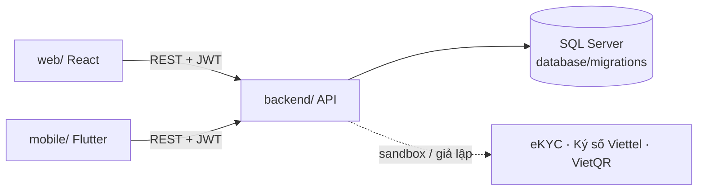

# CrabShare

Nền tảng gọi vốn – nuôi – bán – quyết toán **cua nuôi hộp** trên một hệ thống (đồ án FA26SE229).
Nhà đầu tư chia **Revenue Pool = doanh thu thực thu từ đơn hàng − chi phí chuẩn đã khoá trước khi gọi vốn**, nên không vế nào do hộ nuôi tự khai.

| Thư mục | Là gì | Công nghệ |
|---|---|---|
| [`backend/`](backend/README.md) | API dùng chung cho web và mobile | ASP.NET Core .NET 10, EF Core, SQL Server |
| [`web/`](web/README.md) | Web cho nhà đầu tư, hộ nuôi, khách hàng, quản trị | React 19, Vite, TypeScript |
| [`mobile/`](mobile/README.md) | App cho nhà đầu tư và hộ nuôi | Flutter 3 |
| [`database/`](database/README.md) | Script tạo CSDL (`V001`, `V002`…) | SQL Server, DbUp |
| [`ml/`](ml/README.md) | Mô hình nhận diện cua (TSK-13) | YOLO → ONNX |
| [`docs/`](docs/README.md) | Kiến trúc, công nghệ, quy ước, quy trình git, **ai làm gì** | — |



## Chạy trên máy (Windows)

**Cần cài:** [.NET 10 SDK](https://dotnet.microsoft.com/download) · SQL Server **LocalDB** (đi kèm Visual Studio, hoặc gói *SQL Server Express LocalDB*) · [Node.js 22+](https://nodejs.org) · [Flutter 3.47+](https://docs.flutter.dev/get-started/install) · Android Studio (máy ảo Android) · Git.

**IDE:** Visual Studio 2026 hoặc VS Code + C# Dev Kit (cần bản hỗ trợ .NET 10) cho backend · VS Code cho web · Android Studio hoặc VS Code cho mobile.

```bash
git clone https://github.com/<owner>/crabshare.git
cd crabshare

# 1. Tạo CSDL (LocalDB) và chạy API — http://localhost:5233/scalar
dotnet tool restore --tool-manifest backend/dotnet-tools.json
dotnet run --project backend/tools/CrabShare.DbMigrator
dotnet run --project backend/src/CrabShare.Api --launch-profile http

# 2. Web — http://localhost:5173 (mở terminal khác)
cd web && npm ci && npm run dev

# 3. Mobile — mở trên Chrome (terminal khác)
cd mobile && flutter pub get && flutter run -d chrome --web-port 8080
```

Không có LocalDB (macOS): `docker compose up -d sqlserver` rồi xem `database/README.md`.

## Tài khoản demo

Tạo tự động khi API chạy lần đầu ở môi trường Development. Mật khẩu chung nằm ở hằng `DemoPassword` trong
`backend/src/CrabShare.Api/Infrastructure/Persistence/DevDataSeeder.cs` (web và app có nút đăng nhập nhanh khi chạy dev).

| Email | Vai trò |
|---|---|
| `admin@crabshare.local` | Quản trị nền tảng |
| `reviewer@crabshare.local` | Thẩm định bằng chứng |
| `operator@crabshare.local` | Chủ hộ nuôi (HTX Nuôi cua Năm Căn) |
| `staff@crabshare.local` | Nhân viên hộ nuôi |
| `investor1@crabshare.local`, `investor2@crabshare.local` | Nhà đầu tư (kiêm khách hàng) |
| `customer@crabshare.local` | Khách hàng |

## Làm việc nhóm

1. Đọc [`docs/conventions.md`](docs/conventions.md) và [`docs/git-workflow.md`](docs/git-workflow.md).
2. Xem module của mình trong [`docs/feature-map.md`](docs/feature-map.md); đọc `backend/src/CrabShare.Api/Features/<Module>/README.md`.
3. Nhận task trên Jira (dự án `CS`), tạo nhánh `feature/CS-<số>-...`, mở Pull Request, cần 1 người duyệt + CI xanh.

| Người | Phụ trách |
|---|---|
| **Thiện** (trưởng nhóm) | Góp vốn, hợp đồng, thanh toán, quyết toán, cấu hình phí, nhật ký kiểm toán |
| **Viên** | Hộ nuôi, đánh số hộp, lô & chi phí chuẩn, nhật ký nuôi, thu hoạch – tem – truy xuất, nghiên cứu TSK-12 |
| **Nhân** | Niêm yết, giỏ hàng – đơn hàng – đặt trước – khiếu nại, bao tiêu, mô hình AI TSK-13, kiểm thử hệ thống |
| **Khôi** | eKYC & tài khoản, bằng chứng & thẩm định, cảnh báo, danh mục nhà đầu tư, dashboard, khung mobile, triển khai |

## Nguyên tắc không đổi
- Tiền là **số nguyên đồng**. Không hiển thị **lợi suất kỳ vọng** ở bất kỳ đâu.
- Tiền không đi qua CrabShare: trung gian thanh toán giữ, CrabShare chỉ phát lệnh và đối soát.
- Các nhà cung cấp ngoài (eKYC, ký số, thanh toán) chỉ chạy **sandbox / giả lập**.
