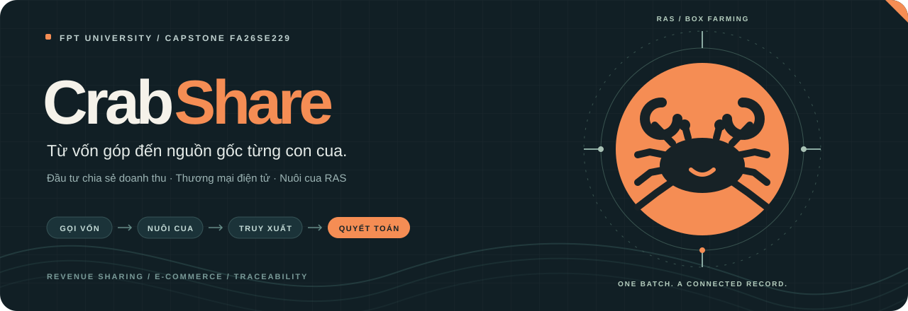
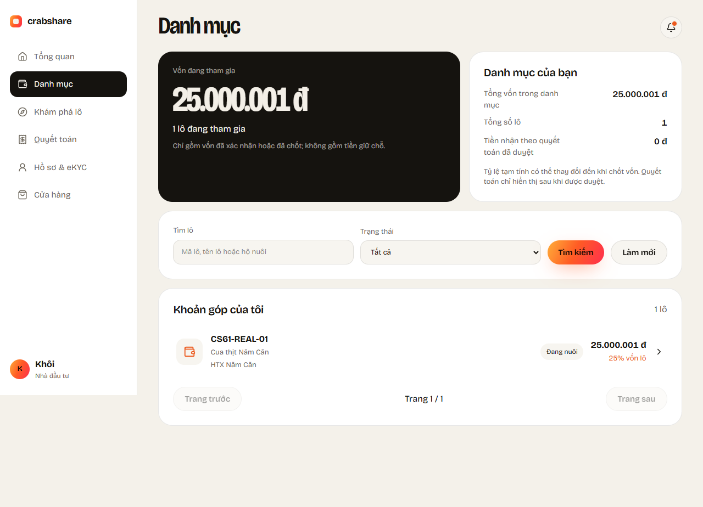
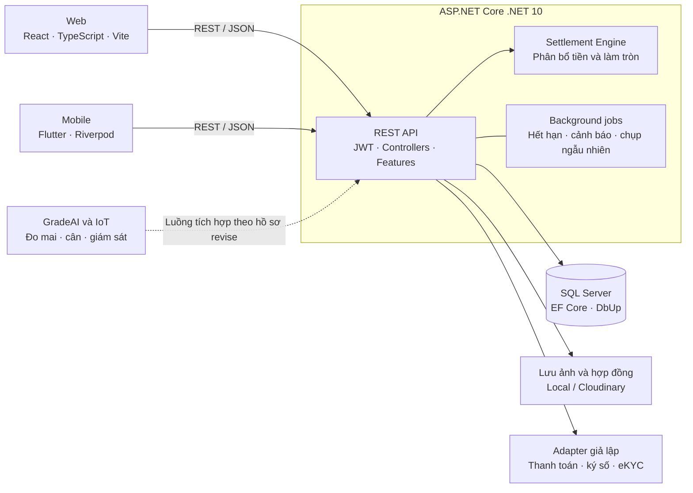

<div align="center">



<h1>CrabShare</h1>

<p><strong>Gọi vốn · Theo dõi nuôi · Truy xuất · Bán hàng · Quyết toán</strong></p>

<p>Nền tảng đầu tư chia sẻ doanh thu kết hợp thương mại điện tử<br>cho mô hình nuôi cua trong hệ thống tuần hoàn nước RAS.</p>

<p>
  <a href="https://github.com/thienhoibai/crabshare/actions/workflows/ci.yml"></a>
  
  
  
</p>

<p>
  
  
  
  
  
</p>

<p>
  <a href="#tong-quan">Tổng quan</a> ·
  <a href="#tinh-nang">Tính năng</a> ·
  <a href="#kien-truc">Kiến trúc</a> ·
  <a href="#bat-dau">Bắt đầu</a> ·
  <a href="#kiem-thu">Kiểm thử</a> ·
  <a href="#tai-lieu">Tài liệu</a> ·
  <a href="#doi-ngu">Đội ngũ</a>
</p>

<p>
  <a href="https://crabshare.vercel.app">Demo web</a> ·
  <a href="https://github.com/thienhoibai/crabshare/actions">GitHub Actions</a> ·
  <a href="https://nguyendaothien2003.atlassian.net/jira/software/projects/CS/boards/2/backlog">Jira</a>
</p>

</div>

<a name="tong-quan"></a>

## ✨ Tổng quan

**CrabShare kết nối nhà đầu tư, hộ nuôi và người mua trong cùng một vòng đời lô nuôi:** từ phê duyệt chi phí, huy động vốn, ký hợp đồng đến ghi nhận sản xuất, thu hoạch, bán hàng và quyết toán. Mỗi con cua được theo dõi qua hộp nuôi có số định danh và tem truy xuất khi thu hoạch.

Trong mô hình RAS (*Recirculating Aquaculture System*), nước được xử lý và tuần hoàn; mỗi con cua được nuôi trong một hộp riêng. CrabShare tổ chức dữ liệu và giao dịch xoay quanh **Batch — lô nuôi**, giúp nhà đầu tư theo dõi vốn, hộ nuôi quản lý vận hành và người mua xem nguồn gốc sản phẩm.

| Vấn đề | Cách CrabShare tiếp cận |
|---|---|
| Tranh chấp chi phí sau thu hoạch | Phê duyệt và khóa **Standard Cost** trước khi mở gọi vốn, gồm dự phòng hao hụt |
| Thiếu thông tin về quá trình nuôi | Nhật ký theo lô, sự kiện từng hộp, ảnh bằng chứng, cảnh báo và hàng đợi thẩm định |
| Doanh thu chỉ do hộ nuôi tự khai | Tổng hợp doanh thu thực thu từ đơn hàng hoàn tất trong hệ thống |
| Đầu tư, bao tiêu và mua hàng rời rạc | Liên kết góp vốn, hợp đồng, tồn kho, đơn hàng, tem cua và bảng quyết toán |

**Thông tin đề tài:** FA26SE229 · Chuyên ngành Kỹ thuật phần mềm · Thời gian 09–12/2026. Phạm vi nghiệp vụ tham chiếu **Business Rule v1.5 và Phiếu đăng ký đề tài v1.7 ngày 09/11/2026**.

<details>
<summary><strong>Xem tên đề tài đầy đủ</strong></summary>

- **Tiếng Việt:** CrabShare — Nền tảng đầu tư chia sẻ doanh thu kết hợp thương mại điện tử cho mô hình nuôi cua trong hệ thống RAS.
- **English:** CrabShare — A Revenue-Sharing Investment and E-Commerce Platform for Crab Farming in Recirculating Aquaculture Systems.

</details>

### Giao diện thực tế



*Màn hình danh mục nhà đầu tư từ bộ ảnh kiểm thử trong repository; số liệu trong ảnh là dữ liệu kiểm thử.*

<a name="tinh-nang"></a>

## 🚀 Tính năng và phạm vi triển khai

### Phạm vi revise theo Review 2

CrabShare tổ chức mạng lưới B2B theo Lô thương mại (CommercialBatch), kết nối nhà cung cấp, người nuôi, nhà đầu tư và người mua sỉ. Lô có thể có lưu nuôi trong RAS hoặc bán sau khi nhận và kiểm phẩm. Phiếu v1.7 ghi trạng thái sửa đổi **Chờ duyệt**. Các quy trình dưới đây là phạm vi của hồ sơ revise; mức hoàn thành cần đối chiếu mã nguồn và nghiệm thu.

| Chế độ Lô | Bên tạo và thực hiện | Phạm vi |
|---|---|---|
| P — Hợp tác lô | Operator tạo, nhà đầu tư góp vốn và chia kết quả | Làm trọn vòng đời |
| T — CrabShare mua bán | Admin tạo, CrabShare sở hữu hàng và chịu rủi ro | Dữ liệu, hợp đồng và quyết toán |
| A — Kết nối đại lý | Admin tạo, nhà cung cấp bán trực tiếp, CrabShare nhận hoa hồng | Dữ liệu, hợp đồng và quyết toán |

### Vai trò

| Vai trò | Trách nhiệm |
|---|---|
| Nhà đầu tư | eKYC hoặc xác minh tổ chức, góp vốn, ký, theo dõi Lô, phản hồi quyết toán, nhận chi trả và biểu quyết |
| Operator | Hồ sơ người nuôi, trại/dàn/hộp, lô P, kế hoạch chi phí, mua nguồn hàng, chăm sóc, đo và giao hàng |
| Khách B2B | Nhà hàng, vựa, đại lý, tiểu thương, bếp trung tâm; đặt theo quy cách, cọc, nghiệm thu và khiếu nại |
| QC Inspector | Kiểm từng con, kiểm cảm quan, duyệt hạng, xác nhận ca giữ lại và thăm trại |
| Admin | Duyệt đối tác, Lô, quy tắc phân hạng, giải ngân, quyết toán; quản lý thiết bị, đối soát và tranh chấp |
| Người thẩm định | Kết luận bằng chứng bị gắn cờ theo quyền được cấp |
| Nhà cung cấp, bên cam kết thu mua | Đối tác được Operator/Admin ghi nhận và xác minh |

Người nuôi dùng tài khoản đại diện. QC được phân ngẫu nhiên từ pool, loại trừ quan hệ lợi ích với Lô. Quyền kiểm phẩm và thẩm định bằng chứng được cấp riêng.

### Vòng đời nghiệp vụ

| Workflow | Nội dung |
|---|---|
| WF-01 | Xác minh đối tác; eKYC đạt trước giữ chỗ; khai ngân hàng, số tài khoản và tên chủ tài khoản trùng tên pháp lý trước khi nhận tiền |
| WF-02 | Chọn chế độ, nguồn hàng, chi phí, hợp đồng, giá sàn, bậc thù lao và mốc giải ngân; Admin duyệt trước mở gọi vốn/bán |
| WF-03 | Lô P góp theo số tiền hoặc %, giữ chỗ mặc định 30 phút, trả VietQR; ký tuần tự qua Viettel song song thanh toán; đủ tiền và chữ ký mới xác nhận |
| WF-04 | Đặt trước theo số con/kg, quy cách và hạng tối thiểu; cọc và chia nhiều đợt giao |
| WF-05 | Đơn mua nguồn, lô nguồn, nhận hàng, QC từng con, mã cua nội bộ, hộp, nhật ký, thiết bị, bằng chứng và giải ngân |
| WF-06 | Trạm đo, AI đề xuất và QC duyệt; phân bổ cua, cân hai lần, nghiệm thu theo đợt, hóa đơn, thanh toán và khiếu nại |
| WF-07 | Hoàn tiền khách, đối soát, công bố quyết toán, phản hồi 7 ngày, Admin duyệt và phát lệnh chi; đóng Lô khi mọi lệnh thành công |

BR-071 lưu thứ tự ký của từng bên, chưa gán cố định người nuôi hay nhà đầu tư ký trước. Hết hạn gọi vốn, khoản thiếu tiền hoặc chữ ký được loại khỏi vốn xác nhận và hoàn phần đã trả. Mở Lô còn cần đạt vốn tối thiểu khả thi và tỷ lệ đặt trước.

Nhà đầu tư thấy **đã góp, đã giải ngân, còn giữ** từ giao dịch đã đối soát. Mốc giải ngân giữa vụ cần biên bản thăm trại của QC được phân công, kèm ảnh vị trí, giờ máy chủ và số hộp trước khi Admin duyệt.

### Quyết toán lô P theo BR-188–BR-199

```text
Phí nền tảng = tỷ lệ phí đã chốt × doanh thu thực thu
Revenue Pool = doanh thu thực thu − phí nền tảng − chi phí trừ
Thù lao người nuôi = tỷ lệ theo bậc tỷ lệ sống × Pool, khi Pool > 0
Khoản nhận nhà đầu tư = vốn góp + tỷ lệ vốn × (Pool − thù lao), khi Pool ≥ 0
```

Chi phí trừ dùng Chi phí chuẩn hoặc chi phí thực tế hợp lệ có chứng từ theo cơ sở đã chọn trong hợp đồng. Pool âm chia lỗ theo vốn, tối đa bằng vốn góp của từng nhà đầu tư; người nuôi chịu phần lỗ còn lại nếu có và không nhận thù lao. Phí nền tảng vẫn tính trên doanh thu thực thu khi vụ lỗ.

Tiền lưu bằng số nguyên VND, tính bằng số thập phân cố định và phân bổ theo phần dư lớn nhất. Tài khoản riêng của Lô tại trung gian thanh toán giữ dòng tiền; CrabShare đối soát và phát lệnh. Lệnh chi lỗi gửi lại sau khi sửa thông tin nhận tiền, giữ nguyên khoản chi.

Ví dụ của BR v1.5, doanh thu 300 triệu, Chi phí chuẩn 100 triệu và phí minh họa 2% cho Pool 194 triệu. Bậc thù lao 10% cho người nuôi 19,4 triệu, còn 174,6 triệu chia theo vốn, cộng vốn khi tính khoản nhận. Tỷ lệ thực tế phải được chốt trong hợp đồng.

## IoT trạm cân và đánh giá chất lượng GradeAI

Thiết kế đầy đủ theo BR-223–BR-227 gồm hộp kín, camera trên nóc, khay mica có ArUco đặt trên load cell + HX711, LED trắng, hai LED đỏ dưới khay, công tắc cửa, nút bấm, đèn báo và Raspberry Pi có Wi-Fi.

1. Operator mở lượt đo gắn mã cua và thiết bị.
2. Trạm kiểm cửa, hiệu chuẩn và độ ổn định cân.
3. Trạm cân, chụp ảnh trắng và ảnh soi đỏ, gửi bản tin kèm định danh và thời điểm.
4. AI đo chiều dài, chiều rộng, diện tích mai và dải xuyên sáng viền mai; hệ thống đề xuất size và hạng.
5. QC kiểm cảm quan và an toàn thực phẩm, rồi duyệt, giữ lại hoặc loại.

### Nghiên cứu và công thức tham chiếu Trung Quốc

Hồ sơ dự án viện dẫn **Huang và cộng sự (2026), Fishes 11:388** cho bố trí chụp và điểm mốc đo mai; **T/SCFA 0014-2024, bản sửa hiệu lực 01/08/2026** của Hiệp hội Thủy sản Trung Quốc cho quy tắc phân hạng. Thông tin thư mục và ngưỡng dưới đây được ghi theo phiếu v1.7 và BR v1.5.

```text
C = m / CL³
m  = khối lượng nguyên con, gram, từ cân đã hiệu chuẩn
CL = chiều dài mai, cm, từ chỗ lõm giữa trán tới mép sau mai
```

| Nhóm | C đặc cấp | C cấp 1 |
|---|---|---|
| Cua thịt | ≥ 0,66 | ≥ 0,62 và dưới 0,66 |
| Cua cái non | ≥ 0,50 | ≥ 0,47 và dưới 0,50 |
| Cua gạch/gạch dầu | Xếp size và cảm quan | Phân hạng phá hủy sau hấp ngoài phạm vi |

C là chỉ số hình thái. Chiều rộng và diện tích là số đo bổ sung; chiều dài mai được dùng trong công thức C. Admin quản lý bộ quy tắc có phiên bản, Lô giữ bộ đã duyệt tới khi đóng. Nhãn bán ghi phân hạng nội bộ tham chiếu chuẩn. QC quyết định hạng cuối; ảnh lỗi hoặc độ tin cậy thấp chuyển sang đo đối chứng bằng thước kẹp. Độ trong toàn mai dưới đèn đỏ được khảo sát như nghiên cứu phụ, đối chiếu C và đánh giá chuyên gia.

### Phần mềm trạm đang thực thi

Gói GradeAI cung cấp Python trên Raspberry Pi, Picamera2, lgpio đọc HX711 và VL53L0X đo khoảng cách. Các chương trình thử riêng camera, lấy nét, khoảng cách, cân, cửa và đèn hỗ trợ kiểm tra từng linh kiện. Cấu hình nằm trong `cau_hinh.py`, đọc cân trong `hx711_doc.py`, điều phối trong `tram_toi_thieu.py`.

Bản tối thiểu kiểm cửa và hạn hiệu chuẩn 30 ngày; lấy 10 mẫu cân, bỏ hai cực trị, kiểm độ lệch 0,2 g của tám mẫu còn lại; đo khoảng cách rồi chụp, lưu `ket_qua.json` và ảnh. Bản này dùng Enter, một đèn và lưu local. Phần cần hoàn thiện gồm hai chế độ chiếu sáng, nút/đèn trạng thái, lấy bì tự động, liên kết lượt đo và hàng đợi gửi API. Sai số cần được đo trên thiết bị và cua thật.

## IoT tự động giám sát cua bằng camera chạy dàn

Camera tự di chuyển theo cột và tầng hộp, đưa đầu chụp tới vị trí hộp, chiếu hồng ngoại và chụp theo lịch để theo dõi quá trình lưu nuôi.

[Mở mô hình IoT và sơ đồ đi dây](https://crabshare-twin.vercel.app/?view=di-day).

Thiết kế v0.2 gồm ray V-slot, đai GT2 trục X, vít me trục Z, trượt Y và xi lanh điện. Raspberry Pi 3 B+ đặt gần camera NoIR V2, kết hợp đầu đèn hồng ngoại, cảm biến khoảng cách, A4988, L298N, MOSFET, công tắc hành trình và dừng khẩn.

Gói kỹ thuật có hai mô hình FreeCAD cho trạng thái rút đầu dò và đang chụp, script `camera_dan_in3d.py` dựng CAD, `to_mau_chup_anh.py` tạo ảnh, danh sách chi tiết in và báo cáo hình học. Hồ sơ v0.2 ghi **15/15 kiểm tra hình học đạt ở cả hai trạng thái**, đồng thời ghi **chưa in và chưa lắp thử**. Cần đo dàn/hộp thật, kiểm khe hở, hoàn thiện treo dây theo xe, nối ray và che nguồn. Phần mềm điều khiển và gửi ảnh cần được kiểm chứng trên mẫu thực. Phạm vi nghiệm thu là mẫu một dàn hoặc tool giả lập cùng API.

### Dữ liệu thiết bị

BR-114, BR-116 và BR-230 xác định bốn loại thiết bị gồm camera hộp, camera chạy dàn, cụm cảm biến nước và trạm đo. Admin đăng ký và gắn phạm vi. Bản tin có mã duy nhất để gửi lại chỉ ghi một lần; mất mạng lưu tạm, mất kết nối phát cảnh báo.

Ảnh hộp/dàn lưu dưới `DeviceImage`; bằng chứng `EvidenceAsset` có nguồn, người chụp, giờ máy chủ, vị trí, mã hộp/cua và băm ảnh theo quy trình xác thực riêng. Ảnh trạm đo thuộc `MeasurementSession`.

Phiếu v1.7 bổ sung cụm **ESP32 đo nhiệt độ, pH và độ mặn** làm thật để giám sát môi trường và cảnh báo. Tiến độ phần cứng cần cập nhật bằng biên bản thử nghiệm.

### Tình trạng tích hợp

Checkout đăng ký `FakePaymentGateway`, `FakeSigningService` và `FakeEkycProvider` phục vụ phát triển/demo. Các gói IoT được cung cấp ngoài repository. Tài liệu trạm xác nhận chương trình tối thiểu; tài liệu camera xác nhận mô hình CAD và kiểm tra hình học. Kết quả tích hợp phần cứng đầu cuối cần được nghiệm thu.

<a name="kien-truc"></a>

## 🏗️ Kiến trúc và công nghệ

CrabShare là một **monorepo** với API dùng chung cho web và mobile. Backend tổ chức theo **modular monolith**, chia các tính năng thành lát cắt dọc trong `Features/`; database được quản lý bằng script SQL và DbUp.



| Thành phần | Công nghệ chính | Tài liệu |
|---|---|---|
| **Backend** | .NET 10, ASP.NET Core, EF Core 10, JWT Bearer, OpenAPI + Scalar | [`backend/`](backend/README.md) |
| **Web** | React 19, TypeScript 5.8, Vite 6, Tailwind CSS 4, TanStack Query, Zustand, React Router | [`web/`](web/README.md) |
| **Mobile** | Flutter 3.47, Dart, Riverpod, go_router, Dio, secure storage, camera/GPS/QR | [`mobile/`](mobile/README.md) |
| **Database** | SQL Server; SQL-first, DbUp, EF scaffold | [`database/`](database/README.md) |
| **Kiểm thử** | xUnit, FsCheck, Stryker.NET, Playwright, Flutter Test | [Kiểm thử và nghiên cứu](#kiem-thu) |
| **Triển khai** | GitHub Actions, Vercel, Azure App Service + Azure SQL; mẫu Docker/Caddy tùy chọn | [`docs/deploy.md`](docs/deploy.md) |
| **AI dự kiến** | YOLO fine-tuning → ONNX, tích hợp qua `ICrabDetector` | [`ml/`](ml/README.md) |

<details>
<summary><strong>Cấu trúc repository</strong></summary>

```text
crabshare/
├── backend/
│   ├── src/CrabShare.Api/                 # REST API, Features, Infrastructure
│   ├── src/CrabShare.SettlementEngine/    # Logic quyết toán thuần
│   ├── tests/                            # API, database và engine tests
│   └── tools/CrabShare.DbMigrator/        # Chạy SQL migrations
├── web/                                  # Giao diện React
├── mobile/                               # Ứng dụng Flutter
├── database/                             # Migrations và tài liệu tham chiếu
├── ml/                                   # Hướng dẫn phát triển mô hình TSK-13
├── docs/                                 # Kiến trúc, quy ước, kế hoạch, validation
├── deploy/                               # Container, Caddy, smoke checks
├── tools/acceptance/                      # Công cụ kiểm tra nghiệm thu
├── .github/workflows/                     # CI, deploy và phát hành mobile
└── docker-compose.yml                    # SQL Server dùng cho local
```

</details>

<a name="bat-dau"></a>

## ⚡ Bắt đầu trên máy phát triển

### 1. Chuẩn bị

| Công cụ | Yêu cầu |
|---|---|
| Git | Clone và làm việc với repository |
| .NET SDK | **10.x** |
| Node.js | **22.x**, theo cấu hình CI; dùng npm và `package-lock.json` |
| SQL Server | **LocalDB** trên Windows hoặc SQL Server có CSDL riêng; Docker local dùng SQL Server 2022 |
| Flutter | **3.47.7** để khớp CI; Dart theo SDK và ràng buộc trong `pubspec.yaml` |
| Công cụ mobile | Chrome để xem nhanh; Android SDK/emulator hoặc thiết bị để thử camera/GPS/QR |

Visual Studio có workload **ASP.NET and web development** hoặc VS Code + C# Dev Kit đều dùng được cho backend. LocalDB là lựa chọn mặc định của cấu hình Development trên Windows.

Các lệnh dưới dùng **PowerShell**. Bắt đầu từ thư mục muốn lưu dự án:

```powershell
git clone https://github.com/thienhoibai/crabshare.git
Set-Location crabshare
dotnet tool restore --tool-manifest backend/dotnet-tools.json
```

### 2. Tạo CSDL và chạy API

Từ thư mục gốc repository, với LocalDB đã cài:

```powershell
dotnet run --project backend/tools/CrabShare.DbMigrator
dotnet run --project backend/src/CrabShare.Api --launch-profile http
```

Migrator tạo CSDL LocalDB `CrabShareDev` và áp dụng các script `database/migrations/V*.sql` chưa chạy. Ở môi trường Development, khi bật seed và bảng người dùng còn trống, API tạo dữ liệu demo.

| Địa chỉ local | Mục đích |
|---|---|
| [localhost:5233/scalar](http://localhost:5233/scalar) | Xem và thử API; chỉ mở ở Development |
| [localhost:5233/openapi/v1.json](http://localhost:5233/openapi/v1.json) | OpenAPI; chỉ mở ở Development |
| [localhost:5233/api/health/live](http://localhost:5233/api/health/live) | Kiểm tra tiến trình API |
| [localhost:5233/api/health/ready](http://localhost:5233/api/health/ready) | Kiểm tra API và kết nối CSDL |

<details>
<summary><strong>Dùng SQL Server qua Docker thay LocalDB</strong></summary>

Compose ở gốc chỉ chạy SQL Server. Đặt mật khẩu local của bạn rồi khởi động:

```powershell
$env:MSSQL_SA_PASSWORD = '<mat-khau-local-du-manh>'
docker compose up -d sqlserver
```

Chờ SQL Server sẵn sàng, kết nối `localhost,1433` bằng công cụ SQL với tài khoản `sa`, rồi tạo CSDL nếu chưa có:

```sql
IF DB_ID(N'CrabShareDev') IS NULL
    CREATE DATABASE [CrabShareDev];
```

Trong terminal chạy migrator/API, cấu hình cùng chuỗi kết nối:

```powershell
$env:CRABSHARE_DB = "Server=localhost,1433;Database=CrabShareDev;User Id=sa;Password=$env:MSSQL_SA_PASSWORD;TrustServerCertificate=True"
$env:ConnectionStrings__Default = $env:CRABSHARE_DB
dotnet run --project backend/tools/CrabShare.DbMigrator
dotnet run --project backend/src/CrabShare.Api --launch-profile http
```

Migrator chỉ tự tạo database với **LocalDB**; SQL Server Docker/remote cần có database trước. Mật khẩu và cấu hình trên chỉ dùng cho local; hướng dẫn triển khai nằm ở [`docs/deploy.md`](docs/deploy.md).

</details>

### 3. Chạy web

Mở terminal mới tại thư mục gốc:

```powershell
Set-Location web
npm ci
if (!(Test-Path .env.local)) { Copy-Item .env.example .env.local }
npm run dev
```

Mở [localhost:5173](http://localhost:5173). `VITE_API_URL` trong `.env.local` mặc định là `http://localhost:5233`; chỉ cần sửa nếu API chạy ở địa chỉ khác. Nếu đã có `.env.local`, giữ cấu hình hiện tại thay vì chép đè.

### 4. Chạy mobile

Mở terminal mới tại thư mục gốc:

```powershell
Set-Location mobile
flutter pub get
flutter run -d chrome --web-port 8080
```

Mở [localhost:8080](http://localhost:8080) để xem nhanh. Trên **Android Emulator**, chọn thiết bị trong `flutter devices` và chạy:

```powershell
$deviceId = 'emulator-5554' # Thay bằng ID trong flutter devices
flutter run -d $deviceId --dart-define=API_URL=http://10.0.2.2:5233 --dart-define=WEB_URL=http://10.0.2.2:5173
```

`10.0.2.2` là địa chỉ máy host đối với Android Emulator. Với điện thoại thật, dùng API HTTPS đã triển khai hoặc cấu hình LAN phù hợp; kiểm thử camera, vị trí, quét tem và bản APK theo [`hướng dẫn demo mobile`](docs/demo-app.md).

### Cấu hình thường dùng

| Thành phần | Biến / khóa | Ý nghĩa |
|---|---|---|
| Migrator | `CRABSHARE_DB` | Chuỗi kết nối SQL thay mặc định LocalDB |
| API | `ConnectionStrings__Default` | Chuỗi kết nối SQL cho API |
| API | `Jwt__SigningKey` | Khóa ký JWT; tối thiểu 32 ký tự |
| API | `Payments__WebhookSecret` | Xác thực webhook thanh toán |
| API | `Cors__Origins__0` | Origin client được phép gọi API; thêm các chỉ số tiếp theo khi cần |
| API | `Storage__Provider`, `Storage__RootPath` | Chọn `Local`/`Cloudinary` và thư mục lưu tệp |
| API | `Security__DataProtectionKeyPath` | Thư mục khóa bảo vệ dữ liệu, cần lưu bền vững khi triển khai |
| API | `Seed__Enabled`, `Trace__PublicBaseUrl` | Bật seed Development và địa chỉ web truy xuất |
| Web | `VITE_API_URL` | Địa chỉ API, đọc lúc build |
| Mobile | `API_URL`, `WEB_URL` | Dart defines cho API và liên kết sang web |

Cấu hình Cloudinary và cách truy cập ảnh có phân quyền: [`docs/cloudinary.md`](docs/cloudinary.md). Giá trị bí mật đặt ngoài Git; `.env.example` là mẫu cấu hình.

<a name="kiem-thu"></a>

## ✅ Kiểm thử và nghiên cứu

### Các lệnh kiểm tra

| Phạm vi | Thư mục chạy | Lệnh |
|---|---|---|
| Build backend | Gốc repository | `dotnet build backend/CrabShare.sln -c Release` |
| Backend không cần CSDL, như CI | Gốc repository | `dotnet test backend/CrabShare.sln -c Release --no-build --filter "Category!=Database"` |
| Database integration | Gốc repository | `dotnet test backend/CrabShare.sln --filter "Category=Database"` |
| Web: TypeScript + bản build | `web/` | `npm run build` |
| Web: kiểm thử giao diện | `web/` | `npm run test:kyc` |
| Mobile: phân tích và widget/unit tests | `mobile/` | `flutter analyze` rồi `flutter test` |
| Công cụ smoke deploy | Gốc repository | `python -m unittest discover -s deploy -p test_smoke.py` |

Chạy build trước lệnh backend có `--no-build`. Database tests hiện dùng **Windows LocalDB**, tạo CSDL kiểm thử riêng và được loại khỏi CI. Script `test:kyc` chạy toàn bộ bộ Playwright dù tên vẫn là `kyc`; local dùng Chrome đã cài, CI cài Chromium. Các bài UI có mock API, nên kết quả của chúng cần được bổ sung bằng nghiệm thu tích hợp thực tế.

[Workflow CI](.github/workflows/ci.yml) kiểm tra container API/migrator, build và test backend không cần CSDL, build web/Playwright, cùng `flutter analyze` và `flutter test`. Badge CI đầu trang dẫn đến workflow; xem kết quả từng lần chạy và nhánh tương ứng trong tab Actions.

### Nghiên cứu và nghiệm thu revise

Nghiên cứu quyết toán dùng kiểm thử dựa trên thuộc tính, biến hình, mô hình và đột biến cho bất biến tổng tiền, làm tròn, giới hạn lỗ và chuyển trạng thái. Nghiệm thu IoT cần ghi nhận hiệu chuẩn, độ lặp lại cân, sai số đo mai so với thước kẹp, chất lượng ảnh trắng/đỏ, gửi lặp/mất mạng và liên kết đúng hộp/lượt đo.

<a name="tai-lieu"></a>

## Tài liệu của lần revise

Các nguồn được cung cấp ngoài repository gồm Business Rule v1.5, Phiếu FA26SE229 v1.7, GradeAI README và `Di_day_tram_do.html`, hồ sơ camera dàn v0.2 DOCX/PDF, hai mô hình FreeCAD, danh sách chi tiết in và giải thích kích thước. Công thức và ngưỡng trong README được trích theo hồ sơ này; mục tiêu nghiệm thu được kiểm chứng qua kết quả thử thực tế.

Tài liệu trong repo gồm [backend](backend/README.md), [web](web/README.md), [mobile](mobile/README.md), [database](database/README.md), [triển khai](docs/deploy.md) và [quy ước](docs/conventions.md). Đọc kèm phiên bản nghiệp vụ tương ứng. Mô hình tương tác được công bố tại [CrabShare Twin](https://crabshare-twin.vercel.app/?view=di-day).

<a name="doi-ngu"></a>

## 👨‍💻 Đội ngũ phát triển

**Giảng viên hướng dẫn:** Lâm Hữu Khánh Phương — FPT University.

<table align="center">
  <tr>
    <td align="center" width="25%">
      <a href="https://github.com/thienhoibai"><br><strong>Nguyễn Đạo Thiện</strong></a><br>
      <a href="https://github.com/thienhoibai">@thienhoibai</a><br>
      <sub>SE180297 · Trưởng nhóm</sub>
    </td>
    <td align="center" width="25%">
      <a href="https://github.com/zienk"><br><strong>Nguyễn Ngọc Viên</strong></a><br>
      <a href="https://github.com/zienk">@zienk</a><br>
      <sub>SE182672 · Thành viên</sub>
    </td>
    <td align="center" width="25%">
      <a href="https://github.com/hieunhann"><br><strong>Tạ Hiểu Nhân</strong></a><br>
      <a href="https://github.com/hieunhann">@hieunhann</a><br>
      <sub>SE180368 · Thành viên</sub>
    </td>
    <td align="center" width="25%">
      <a href="https://github.com/rakkiu"><br><strong>Võ Tuấn Khôi</strong></a><br>
      <a href="https://github.com/rakkiu">@rakkiu</a><br>
      <sub>SE184567 · Thành viên</sub>
    </td>
  </tr>
</table>

| Thành viên | Phụ trách chính |
|---|---|
| [**Nguyễn Đạo Thiện**](https://github.com/thienhoibai) | Góp vốn, hợp đồng, thanh toán, giải ngân, quyết toán và audit |
| [**Nguyễn Ngọc Viên**](https://github.com/zienk) | Hộ nuôi, hộp/lô, chi phí chuẩn, sản xuất, thu hoạch/truy xuất và nghiên cứu TSK-12 |
| [**Tạ Hiểu Nhân**](https://github.com/hieunhann) | Cửa hàng, đơn/đặt trước, bao tiêu, TSK-13 và kiểm thử hệ thống |
| [**Võ Tuấn Khôi**](https://github.com/rakkiu) | Tài khoản/KYC, bằng chứng/thẩm định, cảnh báo, danh mục/dashboard, khung mobile và triển khai |

### Cách cộng tác

1. Đọc [quy ước](docs/conventions.md), [quy trình Git](docs/git-workflow.md) và [bản đồ tính năng](docs/feature-map.md).
2. Nhận task trên Jira; theo quy trình nhóm, tạo nhánh `feature/CS-<so>-<mo-ta>`, `fix/*` hoặc `docs/*` từ `develop`.
3. Dùng commit dạng `<type>(<scope>): <mô tả ngắn bằng tiếng Anh>`; chạy các kiểm tra phù hợp trước khi mở PR.
4. Mở PR vào `develop`, cần một thành viên khác review và CI đạt. Nhánh `main` nhận các mốc ổn định từ `develop`.

**Giấy phép:** repository hiện chưa có tệp `LICENSE`; chưa công bố giấy phép sử dụng hoặc phân phối mã nguồn.

<div align="center">
<sub>CrabShare · FA26SE229 · FPT University · 2026</sub><br>
<a href="#tong-quan">↑ Về tổng quan</a>
</div>
