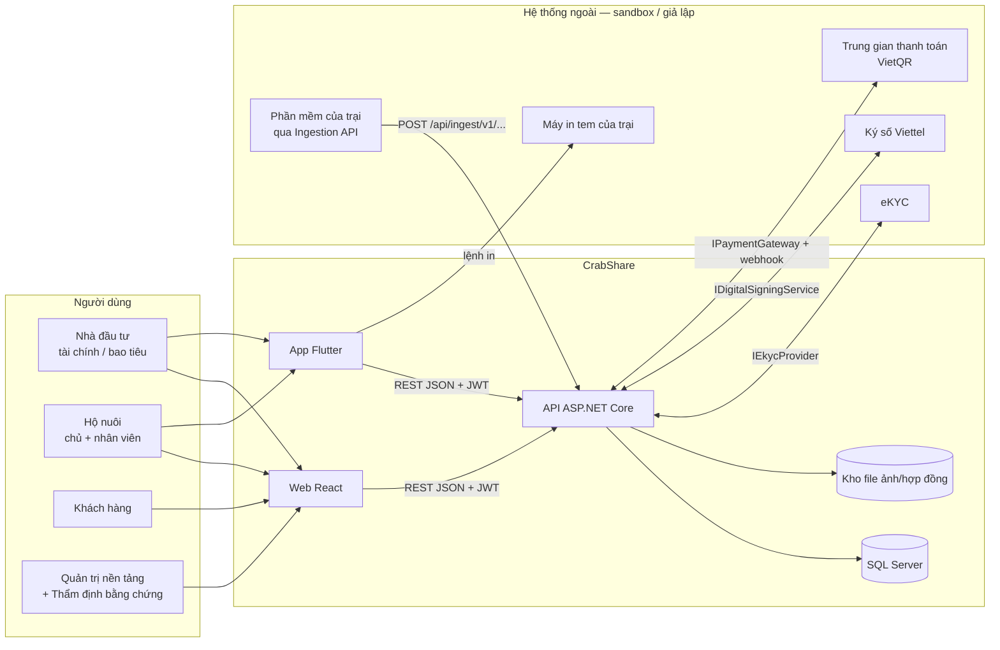
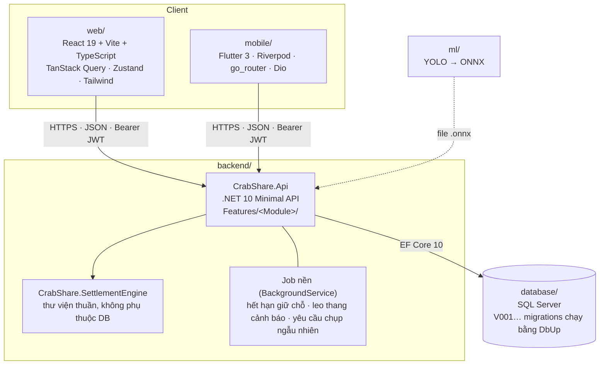
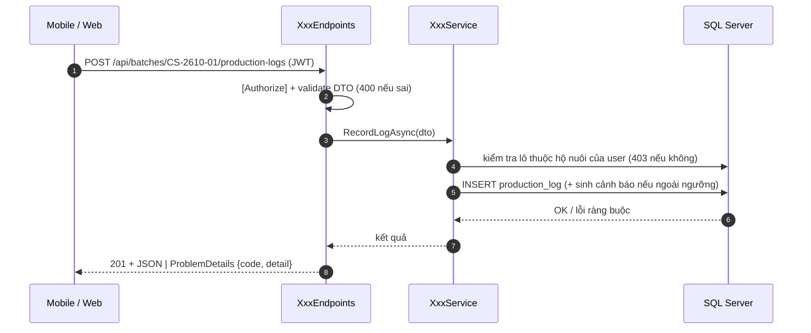
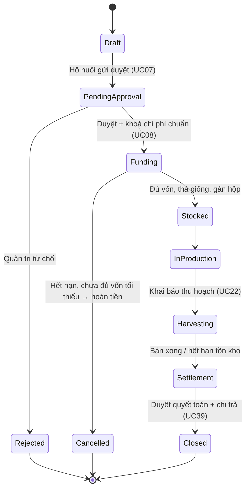
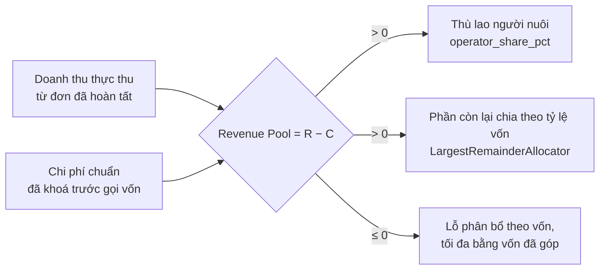

# Kiến trúc CrabShare

Một **API duy nhất** (modular monolith), một **CSDL SQL Server**, hai giao diện: **web React** và **app Flutter**.
Mỗi tính năng là một **lát cắt dọc** (vertical slice) — cùng một người làm từ API tới màn hình.

## 1. Bối cảnh hệ thống



- Tiền **không đi qua CrabShare**: mỗi lô có tài khoản chuyên dùng ở trung gian thanh toán; CrabShare chỉ phát lệnh và đọc thông báo giao dịch (TL-02).
- Mọi hệ thống ngoài nằm sau một **interface** trong `Infrastructure/`. Bản dev dùng bản giả (`Fake*`), đổi sang bản thật chỉ sửa `DependencyInjection.cs`.

## 2. Các khối (container) và công nghệ



## 3. Cấu trúc backend — lát cắt dọc

```
backend/src/CrabShare.Api/
├── Program.cs                     ← chỉ ghép nối, không viết logic
├── Common/
│   ├── Auth/                      ← JWT, vai trò, ICurrentUser
│   ├── Errors/                    ← AppException → ProblemDetails (mã lỗi "code")
│   ├── Endpoints/FeatureRegistry.cs  ← NƠI DUY NHẤT đăng ký module
│   └── Paging/
├── Infrastructure/
│   ├── Persistence/               ← AppDbContext + Entities (sinh từ CSDL, KHÔNG sửa tay)
│   ├── Payments/ Signing/ Ekyc/ Detection/ Storage/   ← interface + bản giả
└── Features/
    ├── Auth/                      ← MẪU: Dtos + Service + Endpoints
    ├── Batches/  Funding/  Production/  Orders/  Settlement/ ...
```

Mỗi module gồm 3 file (thêm file khi cần, không tạo tầng thừa):

| File | Chứa gì |
|---|---|
| `<Module>Dtos.cs` | record request/response + DataAnnotations để validate |
| `<Module>Service.cs` | toàn bộ nghiệp vụ, dùng `AppDbContext` trực tiếp (không repository riêng) |
| `<Module>Endpoints.cs` | `Map<Module>Endpoints()` — route, phân quyền, gọi service |



## 4. Cấu trúc web và mobile

```
web/src/                                mobile/lib/
├── app/        router, providers       ├── app/       router (theo vai trò), theme
├── shared/     api (axios), auth,      ├── core/      api (dio), auth (phiên), format
│               layout, ui kit          ├── shared/    widgets (gauge, thẻ, nav), models
└── features/   theo khu vực/vai trò    └── features/  investor/ operator/ trace/ ...
                                                        mỗi tính năng: data/ (repository) + màn hình
```

- Web gọi API qua `shared/api/http.ts` (tự gắn token, 401 → đăng xuất).
- Mobile gọi API qua `core/api/api_client.dart`; mỗi tính năng có **repository interface + bản Mock**. Khi API xong: viết bản `Api...Repository` và đổi **một dòng** provider.

## 5. Vòng đời lô (state machine)



Chặn chuyển trạng thái sai ở **cả hai nơi**: service (trả 422 `batch.invalid_transition`) và trigger CSDL (lỗi ≥ 50000 → 422 `db.rule`).

## 6. Quyết toán (trọng tâm đề tài)



- Tiền là **số nguyên đồng** (`long` ở C#, `DECIMAL(18,0)` ở SQL, `int` ở Dart/TS). Không dùng `double` cho tiền.
- `CrabShare.SettlementEngine` là thư viện thuần → kiểm thử bằng property-based (FsCheck) và mutation testing (Stryker) cho TSK-12.

## 7. Bảo mật và phân quyền

| Vai trò (claim `role`) | Vào được |
|---|---|
| `Investor` | `/nha-dau-tu/*` (web), app tab Nhà đầu tư |
| `Customer` | cửa hàng, giỏ hàng, đơn hàng |
| `OperatorMember` (+ claim `operator_id`) | `/operator/*` (web), app tab Hộ nuôi — chỉ dữ liệu của hộ nuôi mình |
| `PlatformAdmin` | `/admin/*` |
| `EvidenceReviewer` | hàng đợi thẩm định — **không** thẩm định lô mình đã góp vốn |

- Phân quyền theo lô làm trong service (`ICurrentUser.RequireOperatorId()` rồi so với `batch.operator_id`).
- Không lưu ảnh giấy tờ eKYC, chỉ lưu kết quả. Mật khẩu băm bằng `PasswordHasher`.
- **Không hiển thị lợi suất kỳ vọng** ở bất kỳ màn hình nào (TL-05 §8, BR-49).
