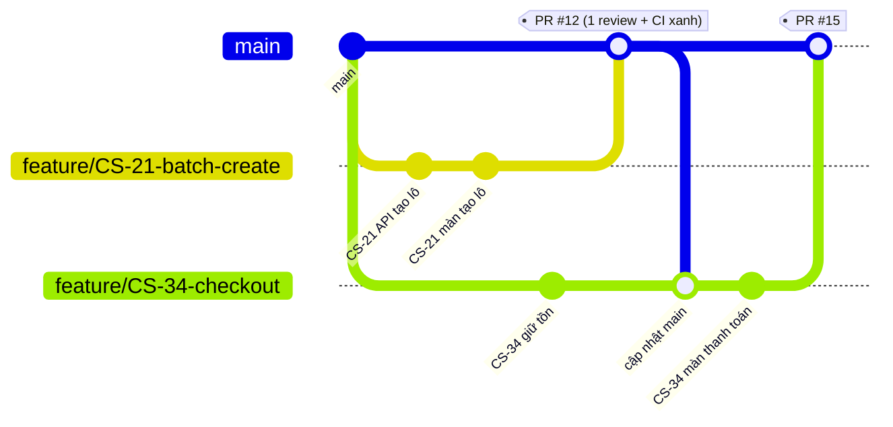

# Quy trình Git + Jira



## Quy tắc

1. **`main` luôn chạy được.** Không push thẳng lên `main`; mọi thay đổi đi qua Pull Request.
2. **Một task Jira = một nhánh = một PR.** Nhánh sống tối đa 1–2 ngày.
3. Tên nhánh: `feature/CS-<số>-<mo-ta-ngan>`, `fix/CS-<số>-...`, `docs/CS-<số>-...`.
   Có mã `CS-<số>` thì Jira tự gắn nhánh/commit/PR vào task.
4. Commit: `CS-21: thêm API tạo lô nháp` — ngắn, nói việc đã làm.
5. PR cần **1 người khác duyệt** + **CI xanh** mới merge. Chọn **Squash and merge**.
6. Trước khi mở PR: `git pull origin main` vào nhánh của mình, chạy test (xem `conventions.md` mục 4).

## Một ngày làm việc

```bash
git checkout main
git pull
git checkout -b feature/CS-21-batch-create
# ... code ...
git add -A
git commit -m "CS-21: thêm API tạo lô nháp"
git push -u origin feature/CS-21-batch-create
# mở PR trên GitHub, gắn người review, kéo task Jira sang "In Review"
```

## Khi bị xung đột (conflict)

- Hay gặp nhất ở `FeatureRegistry.cs`, `web/src/app/router.tsx`, `mobile/lib/app/router.dart`: giữ **cả hai** phần (của mình và của người kia).
- File sinh tự động (`Infrastructure/Persistence/Entities/*`, `AppDbContext.cs`): không sửa tay — chạy lại lệnh scaffold sau khi pull.
- Không chắc thì hỏi người kia trước khi chọn.

## Trạng thái task trên Jira

`To Do` → `In Progress` (đã tạo nhánh) → `In Review` (đã mở PR) → `Done` (PR đã merge, đã thử trên máy).

## Không commit

- Mật khẩu, khoá thật, chuỗi kết nối thật. `appsettings.Development.json` chỉ chứa giá trị dev.
- Thư mục `bin/`, `obj/`, `node_modules/`, `build/`, `storage/` (đã có trong `.gitignore`).
