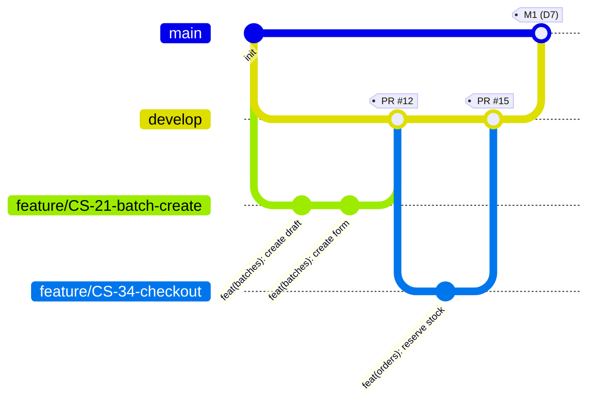

# Quy trình Git + Jira

Theo đúng Report 2 mục 6.2 (Source Code Management): một repository, ba thư mục; nhánh `main` / `develop` / `feature/*` / `fix/*` / `docs/*`; commit theo dạng `<type>(<scope>): <mô tả tiếng Anh>`.



## Các nhánh

| Nhánh | Dùng để | Ví dụ |
|---|---|---|
| `main` | Code ổn định, đã kiểm thử, dùng để demo. **Không push thẳng**; chỉ nhận `develop` ở mỗi mốc (M1 D7, M2 D14, M3 D19, M4 D21) | — |
| `develop` | Nơi gộp tính năng của cả nhóm và thử chung. **Nhánh mặc định** — mọi PR nhắm vào đây | — |
| `feature/*` | Tính năng mới, **một nhánh cho một task Jira**, tạo từ `develop` | `feature/CS-12-settlement-engine` |
| `fix/*` | Sửa lỗi | `fix/CS-35-duplicate-webhook` |
| `docs/*` | Tài liệu | `docs/CS-40-api-documentation` |

Có mã `CS-<số>` trong tên nhánh thì Jira tự gắn nhánh và PR vào task.

## Quy tắc merge

1. Nhánh chỉ vào `develop` qua **Pull Request** được **một bạn khác duyệt** và **CI xanh**. Chọn *Squash and merge*.
2. Nhánh sống tối đa 1–2 ngày; PR nhỏ dễ review.
3. Trước khi mở PR: cập nhật `develop` mới nhất vào nhánh của mình, chạy test (`conventions.md` mục 4).
4. Trưởng nhóm merge `develop` → `main` ở mỗi mốc sau khi cả nhóm chạy thử chung.

## Commit

Dạng `<type>(<scope>): <mô tả ngắn bằng tiếng Anh>`, mỗi commit một thay đổi:

| type | Ví dụ CrabShare |
|---|---|
| `feat` – tính năng mới | `feat(settlement): compute batch settlement with fixed-point rounding` |
| `fix` – sửa lỗi | `fix(payment): prevent duplicate webhook processing` |
| `test` – kiểm thử | `test(settlement): add FsCheck properties for rounding` |
| `docs` – tài liệu | `docs(api): document settlement endpoints` |
| `refactor` – dọn code | `refactor(order): simplify stock reservation logic` |

`scope` = tên module: `auth`, `accounts`, `operators`, `boxes`, `batches`, `funding`, `contracts`, `payments`, `production`, `evidence`, `alerts`, `harvest`, `catalog`, `orders`, `offtake`, `settlement`, `portfolio`, `admin`, `web`, `mobile`, `db`.

## Một ngày làm việc

```bash
git checkout develop
git pull
git checkout -b feature/CS-21-batch-create
# ... code + test ...
git add -A
git commit -m "feat(batches): create draft batch with standard cost"
git push -u origin feature/CS-21-batch-create
# mở PR vào develop, gắn người review, kéo task Jira sang "In Review"
```

## Khi bị xung đột (conflict)

- Hay gặp ở `FeatureRegistry.cs`, `web/src/app/router.tsx`, `mobile/lib/app/router.dart`: giữ **cả hai** phần (của mình và của người kia).
- File sinh tự động (`Infrastructure/Persistence/Entities/*`, `AppDbContext.cs`): không sửa tay — chạy lại `backend/scripts/scaffold-db.ps1` sau khi pull.
- Không chắc thì hỏi người kia trước khi chọn.

## Trạng thái task trên Jira

`To Do` → `In Progress` (đã tạo nhánh) → `In Review` (đã mở PR) → `Done` (PR đã merge vào `develop`, đã thử trên máy).

## Không commit

- File `.env`, khoá API (ký số Viettel, eKYC, trung gian thanh toán), mật khẩu, access token. Chỉ commit `.env.example` để trống giá trị.
- `appsettings.Development.json` chỉ chứa giá trị dev (khoá ký JWT dev); bản thật đặt qua biến môi trường trên server.
- Thư mục `bin/`, `obj/`, `node_modules/`, `build/`, `storage/` (đã có trong `.gitignore`).
