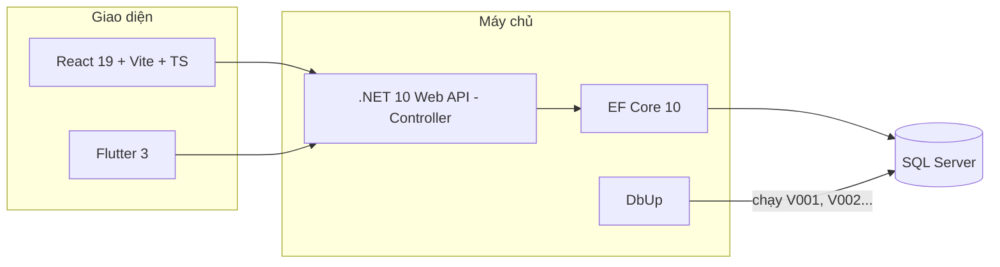

# Công nghệ và lý do chọn

Nguyên tắc: **dùng thứ cả nhóm học được trong 1–2 ngày**, có tài liệu nhiều, chạy được trên Windows không cần cài thêm dịch vụ lạ.
Mọi lựa chọn đều bám stack đã chốt trong Report 2 (ASP.NET Core + React + Flutter + SQL Server).

## Backend

| Công nghệ | Dùng để | Vì sao chọn | Không chọn |
|---|---|---|---|
| **ASP.NET Core .NET 10 Web API — Controller** | Viết REST API | Đã chốt ở Report 2; kiểu `[ApiController]` cả nhóm đã quen, Visual Studio hỗ trợ sẵn; tự trả 400 khi dữ liệu vào sai | Minimal API (ít file hơn nhưng nhóm chưa quen) |
| **Lát cắt dọc theo tính năng** (`Features/<Module>`) | Tổ chức code | Một người sửa một thư mục → ít conflict khi 4 người push cùng lúc | Clean Architecture 4 tầng (quá nhiều project cho 21 ngày) |
| **EF Core 10 — database-first** | Truy vấn CSDL | CSDL đã thiết kế xong bằng SQL; sinh entity bằng lệnh `scaffold`, không viết tay | Code-first migrations (lệch với thiết kế CSDL đã nộp) |
| **DbUp** | Chạy script `V001__...sql` | Script SQL là nguồn sự thật, ai cũng đọc được; chạy lại tự bỏ qua script đã chạy | EF migrations |
| **SQL Server** (LocalDB khi dev) | CSDL | Đã chốt; LocalDB có sẵn khi cài Visual Studio, không cần Docker | PostgreSQL |
| **JWT Bearer** | Đăng nhập | Web và mobile dùng chung một kiểu token | Cookie (khó dùng cho mobile) |
| **ProblemDetails** | Trả lỗi | Chuẩn RFC 9457, web/mobile chỉ cần đọc `code` + `detail` | Mỗi người tự đặt kiểu lỗi |
| **Scalar** (`/scalar`) | Xem + thử API | Có sẵn với OpenAPI của .NET 10, giao diện dễ dùng hơn Swagger UI | — |
| **xUnit + FsCheck** | Kiểm thử | FsCheck cho property-based test của engine quyết toán (TSK-12) | — |
| **Stryker.NET** | Mutation testing | Đo chất lượng bộ test của engine (TSK-12) | — |

## Web

| Công nghệ | Dùng để | Vì sao chọn |
|---|---|---|
| **React 19 + Vite + TypeScript** | Web SPA | Đã có giao diện demo (CS_UI_Demo) viết bằng React → tái sử dụng; Vite chạy nhanh |
| **react-router 7** | Điều hướng + chặn theo vai trò | `RequireRole` bọc nhóm route |
| **TanStack Query** | Gọi API, cache, loading/error | Không phải tự viết `useEffect` + `useState` cho mỗi lần gọi API |
| **axios** | HTTP | Interceptor gắn token, bắt 401 |
| **Zustand** | Lưu phiên đăng nhập | Nhỏ, ít code hơn Redux |
| **Tailwind 4** + CSS sẵn có | Giao diện | Giữ nguyên style bản demo: Cửa hàng bản 1 (nền sáng), Nhà đầu tư bản 2 |
| **three.js / WebGL** | Trang chủ 3D | Giữ nguyên trang chủ demo |

## Mobile

| Công nghệ | Dùng để | Vì sao chọn |
|---|---|---|
| **Flutter 3** | App Android/iOS | Đã chốt; một mã nguồn cho cả hai nền tảng; build được bản web để xem nhanh |
| **material_ui** | Thư viện Material | Từ Flutter 3.44, Material tách khỏi SDK. Import `package:material_ui/material_ui.dart` |
| **Riverpod 3** | Trạng thái + truyền phụ thuộc | Thay repository mock ↔ API bằng một dòng; dễ viết test |
| **go_router** | Điều hướng, chặn theo vai trò | Khai báo route một chỗ; `StatefulShellRoute` cho thanh tab dưới |
| **Dio** | HTTP | Interceptor gắn JWT giống axios bên web |
| **flutter_secure_storage** | Lưu token | Keychain (iOS) / Keystore (Android) |
| **image_picker** | Chụp ảnh bằng chứng | Chỉ mở camera (chụp trực tiếp), không lấy ảnh có sẵn |
| **DM Sans TTF trong assets** | Font theo mẫu thiết kế | Đóng gói 400/500/600/700, dùng offline cho app và test |

## AI (TSK-13)

| Công nghệ | Dùng để | Vì sao chọn |
|---|---|---|
| **YOLO (Ultralytics) đã huấn luyện sẵn → fine-tune** | Nhận diện có cua trong ảnh hộp | Học chuyển giao, ít ảnh vẫn chạy được |
| **ONNX + Microsoft.ML.OnnxRuntime** | Chạy mô hình trong API .NET | Không cần dựng server Python riêng |

## Hạ tầng

| Công nghệ | Dùng để |
|---|---|
| **GitHub** (1 repo, 3 thư mục) + **Pull Request** | Quản lý mã nguồn, review chéo |
| **GitHub Actions** | Tự build + chạy test mỗi PR |
| **Docker Compose** | SQL Server cho máy không có LocalDB (macOS) |
| **Jira** | Quản lý task (key dự án `CS`) |
