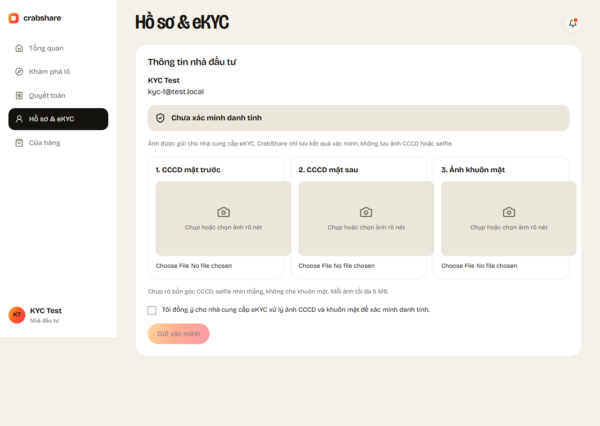
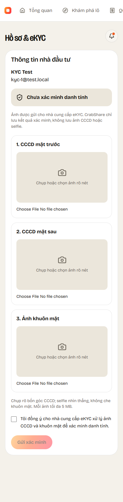
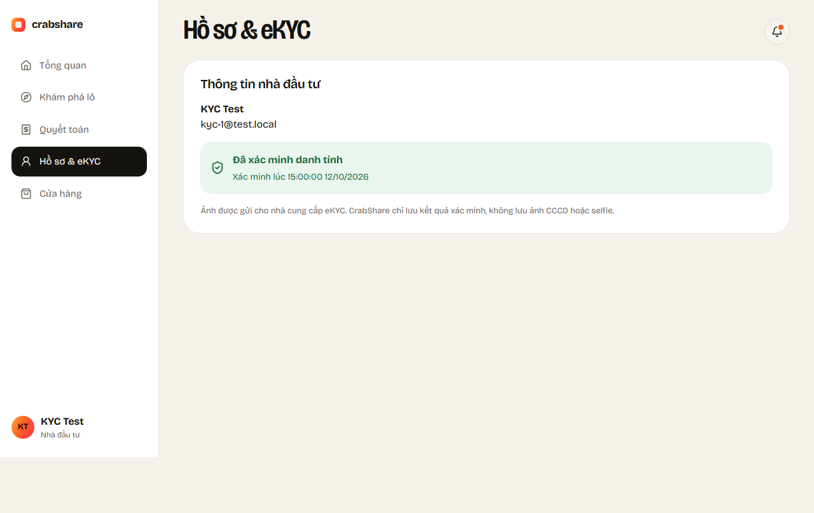

# CS-27 / KH-02 — eKYC trên backend, mobile và web

Nhánh mobile/web: `feature/CS-27-ekyc-clients`. Backend đã merge qua PR:
https://github.com/thienhoibai/crabshare/pull/2.

## Luồng đã triển khai

- Backend nhận multipart 3 ảnh + consent, gọi IEkycProvider giả lập; lưu kết quả,
  cập nhật Verified/Rejected và ghi audit trong transaction.
- Mobile chụp 2 mặt CCCD bằng camera sau, selfie bằng camera trước; consent và đủ
  3 ảnh mới gửi được. Có xử lý camera bị từ chối, ảnh sai/quá dung lượng, mạng lỗi,
  kết quả không đạt và xác minh thành công. Banner Tổng quan đọc KYC từ API.
- Web có mục Hồ sơ & eKYC `/nha-dau-tu/ho-so`, form 3 ảnh, consent, preview cục bộ,
  trạng thái từ API và banner Tổng quan. Cache gắn với tài khoản đang đăng nhập.

## Kiểm tra local

| Kiểm tra | Kết quả |
|---|---|
| Backend (`dotnet test backend/CrabShare.sln`) | 85 test đạt sau khi cập nhật develop (81 API + 4 Settlement) |
| Không consent | 400, không gọi provider, không ghi KYC/audit, trạng thái không đổi |
| Xác minh thành công | Passed + Verified; GET trả kết quả vừa ghi |
| Ảnh không được ghi xuống đĩa server | Storage không được tạo; temp upload trống ngay trong lúc provider xử lý ảnh >64 KB |
| Web (`npm run build`) | Đạt |
| Web (`npm run test:kyc`) | 3 test trình duyệt đạt: form/multipart/consent, lỗi 400, đổi tài khoản |
| Mobile (`flutter analyze`) | Không issue |
| Mobile (`flutter test`) | 33 test đạt; 6 test eKYC mới |
| Android (`flutter build apk --debug --dart-define=API_URL=http://localhost:5233`) | Build APK thành công: `mobile/build/app/outputs/flutter-apk/app-debug.apk` |

Test backend dùng CSDL LocalDB riêng, không thay đổi dữ liệu CrabShareDev. Test
mobile dùng camera thay thế bằng ảnh mẫu; web dùng API mock. Chưa chụp thử eKYC trên
camera điện thoại thật trong lượt này (thiết bị không kết nối USB).

## Thử thủ công

Đăng ký Investor mới (demo đã Verified), chạy backend cổng 5233. Web: mở Hồ sơ &
eKYC. Mobile: đăng nhập → Tài khoản → Xác minh danh tính, đồng ý, chụp đủ 3 ảnh và
gửi. Sau khi đạt, mở Tổng quan để kiểm tra banner không còn yêu cầu xác minh.
Ảnh chỉ chuyển cho provider; provider hiện là giả lập để phát triển/demo.

## Ảnh giao diện web

Các ảnh dùng tài khoản/ảnh mẫu từ test:

