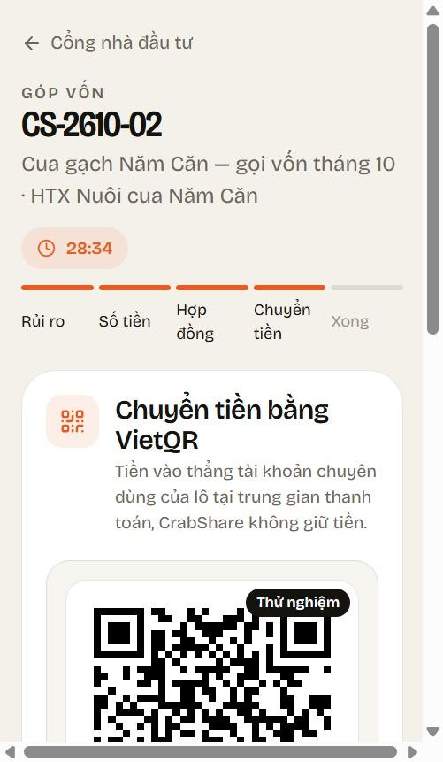
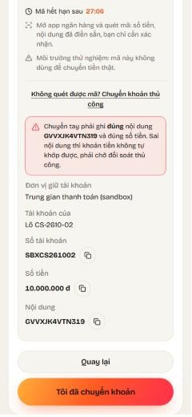
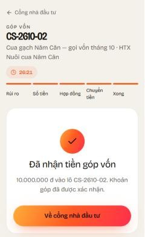
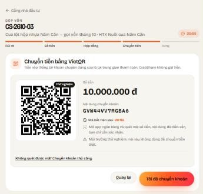

# CS-38 / TH-05 — Thanh toán VietQR dùng chung

Nhánh: `feature/CS-38-thanh-toan-vietqr`, xếp trên CS-32 (TH-04) và CS-21 (TH-02). Merge theo thứ tự CS-21 → CS-32 → CS-38. Không có migration mới.

Kiểm tra trên máy sau khi merge develop (có CS-34, CS-37, CS-40):
- Backend: 262 test API + 4 test quyết toán qua; gộp thêm CS-28 (dữ liệu demo) là 266 test API.
- Web: `npm ci` + `npm run build` qua.
- Mobile: `flutter analyze` sạch, 41 test qua.

Chạy thử trên trình duyệt với dữ liệu demo của CS-28 (tài khoản `investor1`, lô `CS-2610-02` và `CS-2610-03`):
- Màn 4 vừa vào đã tạo mã: `POST /api/contributions/{id}/payment-requests` → 201. Mã đối chiếu `GV` + 11 ký tự, đúng số tiền giữ chỗ, đồng hồ hết hạn trùng hạn giữ chỗ. Nhãn "Thử nghiệm" hiện vì nội dung QR là của `FakePaymentGateway`, không phải mã ngân hàng thật.
- Số tài khoản chỉ hiện sau nút "Chuyển khoản thủ công", kèm cảnh báo ghi đúng nội dung (TL-10 §6.1).
- "Tôi đã chuyển khoản" → màn 5 "Đang chờ tiền về", hỏi lại `GET /api/payment-requests/{id}` 5 giây một lần. Webhook là việc của TH-06, nên lần thử này đổi tay `payment_request.status = 'Paid'` trong CSDL thử: màn hình chuyển sang "Đã nhận tiền góp vốn" trong vòng 5 giây.
- Lùi `expires_at` về quá khứ: mã QR bị ẩn, hiện thông báo hết hạn và nút "Giữ chỗ lại". Giữ chỗ lại thì có mã mới.
- Khổ 375 px (điện thoại) và 768 px (máy tính bảng) không tràn ngang.

| Màn 4 trên điện thoại | Chuyển khoản thủ công | Đã nhận tiền |
|---|---|---|
|  |  |  |

Máy tính bảng:

Còn lại: webhook và giả lập chuyển khoản (TH-06), job hết hạn giữ chỗ (TH-07), điều kiện hợp đồng đã ký trước khi chuyển tiền (TH-08).
