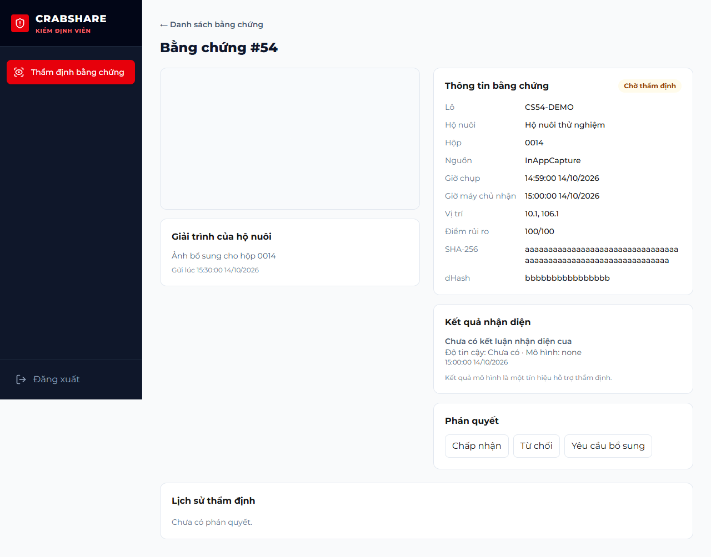
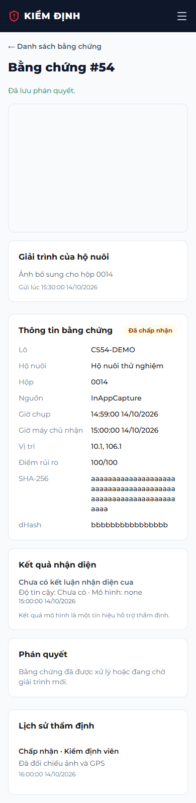

# CS-54 / KH-09 — Review flagged production evidence

Branch: `feature/CS-54-tham-dinh-bang-chung`, based on `origin/develop` at `31a17df`.

## Delivered behavior

The web reviewer queue at `/admin/evidence` replaces the missing review workflow with real API data, status/search filters, pagination, loading/error/retry/empty states and an evidence detail page. The detail includes a private original photo, capture/receive time, GPS, risk score, hashes, detector results, explanation and reviewer decisions. Unknown detector output stays unknown. The page uses the existing admin sidebar, table, field, badge and dialog styling.

Only an active user with the current `EvidenceReviewer` database role and JWT role may access the APIs. `PlatformAdmin` alone does not grant review access. Reviewer sign-in lands on the queue; unrelated admin menus are hidden.

| Method | Endpoint | Contract |
|---|---|---|
| GET | `/api/review/evidence?status=Flagged&q=0014&page=1&pageSize=10` | Paged queue; status defaults to Flagged, oldest first; search by evidence ID, batch, farm or box |
| GET | `/api/review/evidence/{id}` | Metadata, nullable detector results, explanation, decisions and `canReview`; no storage URI |
| GET | `/api/review/evidence/{id}/image` | Authenticated Photo JPEG/PNG/WebP stream; `Cache-Control: no-store`, `X-Content-Type-Options: nosniff` |
| POST | `/api/review/evidence/{id}/verdict` | JSON `{ "verdict": "Pass", "note": "Reviewed capture metadata" }`; trimmed nonblank note, maximum 500 characters |

`Pass` changes `review_status` to `Accepted`; `Fail` changes it to `Rejected`; `NeedMoreEvidence` keeps it `Flagged`. Final decisions and Watch evidence reject new decisions with **409 `evidence.review_changed`**. One decision row exists per evidence/reviewer, as required by the existing unique index. The same reviewer can update a NeedMoreEvidence decision only after a newer `explained_at`; immutable audit snapshots preserve the old verdict/note. Another independent reviewer can decide a still-Flagged item. CS-54 does not add an explanation submission endpoint or a two-reviewer consensus policy.

A capital share, confirmed contribution, or historically confirmed contribution later refunded creates a conflict. A Reserved contribution without confirmation does not. Conflicted batches are excluded from the queue; detail, image and verdict return **403 `evidence.reviewer_conflict`**. Image access checks this before touching storage. Missing images and paths escaping the storage root return 404 without disclosing the path.

The verdict, evidence status and audit commit together in a serializable transaction using the shared `AuditChain` table lock, camelCase snapshots, UTC millisecond timestamps and lowercase SHA-256. Concurrent final decisions have one winner; a failed audit rolls back the review and status. Capture request deadlines/fulfillment are not changed by a review decision. No migration or generated entity edit is needed.

## Validation

Backend integration tests use isolated LocalDB databases and a dedicated temporary storage root, never the development database. Controller tests also run in GitHub's database-free suite.

- Authorization for all four routes; invalid filters, verdicts and notes.
- Capital share, confirmed and refunded conflicts; Reserved access; revoked roles/locked accounts.
- All three verdict mappings, persisted reviewer names/notes, unique re-review behavior and lowercase audit-chain integrity.
- Independent reviewer decisions, concurrent final decisions, closed-status rejection and rollback on audit failure.
- Private original image bytes, cache headers, missing/escaping file paths and absent storage URI in JSON.
- Browser queue filters/search/pagination, JWT Blob image, nullable detector output, note validation, saved verdict/history, 409 recovery, conflict without image access, denied roles, empty/error/retry and 390px layout.

Final local validation: **414 API tests + 4 settlement tests**, **43 browser tests**, **49 Flutter tests** passed. The Release backend build and production web build passed; Flutter analysis found no issues. The 9 CS-54 browser tests also passed independently while capturing the screenshots below. GitHub Actions and the Vercel deployment status are checked separately.

Browser screenshots use synthetic test fixtures, not production evidence:

## Manual check

Run the development backend and web. Log in on **web** with `reviewer@crabshare.local` / `CrabShare@2026`, then open `/admin/evidence`. The reviewer flow is not a mobile role.

To obtain a flagged sample, use the existing local CS-44 demo batch/boxes and upload the same test photo twice through the operator evidence API; duplicate detection flags the second evidence. Inspect the metadata, enter a note, submit a verdict, then filter the queue by the resulting status. Use test evidence because a final verdict cannot be changed through this workflow. Existing phone photos need not be altered.

For the conflict check, use a reviewer who has a confirmed contribution or capital share in that test batch and call detail/image/verdict directly: all must return 403 with `evidence.reviewer_conflict`.
