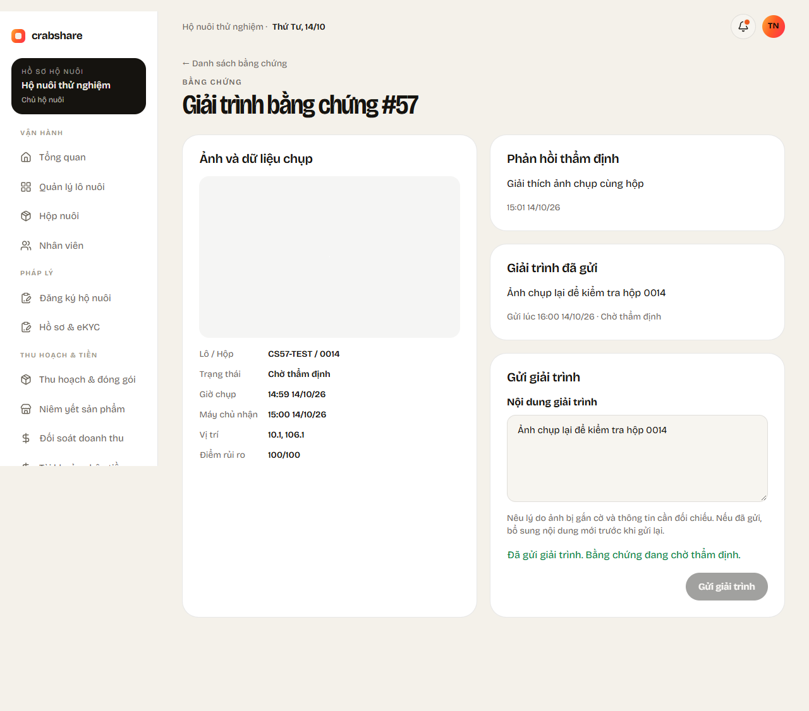
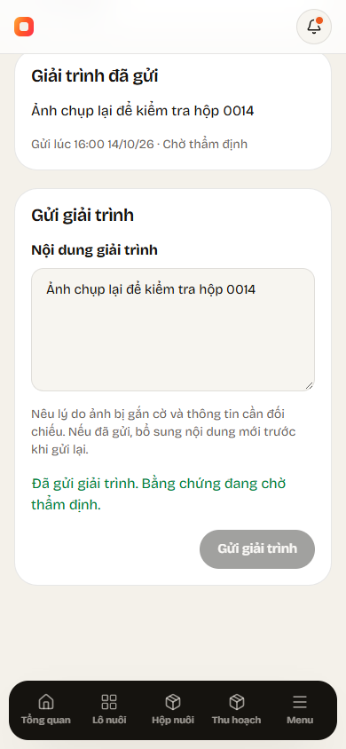

# CS-57 / KH-10 — Production evidence explanations

Branch: `feature/CS-57-giai-trinh-bang-chung`, created after CS-50 and CS-54 were merged and updated to develop at `eb7da8b`, including CS-20 CORS/deployment changes.

## Delivered flow

An operator Owner or Staff member can inspect flagged evidence from their own farm and submit an explanation. The reviewer reads the saved text and timestamp through the existing CS-54 detail API and page. Submitting an explanation keeps the evidence `Flagged`; the reviewer decides whether to accept, reject or ask for more information.

Web: `/operator/evidence` and `/operator/evidence/{id}`. The operator sidebar and Alerts page link to this flow. The list supports status/search filters, pagination and real loading/error/retry/empty states. Detail shows the original private photo, batch/box, capture/receive timestamps, GPS, risk score, latest reviewer note, saved explanation and text form. It follows `OperatorLayout`, `OpPanel`, `OpBadge`, `OpBtn` and current project typography/colors. The form retains drafts on errors, refreshes eligibility on conflicts and prevents duplicate pending submissions.

Mobile: **Cảnh báo → Bằng chứng bị gắn cờ → Giải trình bằng chứng**. The entry point remains available if alert loading fails. Lists, detail, private image bytes and submissions use Dio repositories; no mock fallback or public image URLs. Providers are scoped to the signed-in user, cancel disposed requests, and clear drafts/images when the user changes. The form uses existing cards, fields and buttons; errors retain the draft and a closed evidence disables further submissions.

## API

All routes require JWT `OperatorMember` plus current active database role and farm membership. The farm ID is resolved on the server, never accepted from request JSON. Other farms and missing evidence return 404; revoked permissions return 403.

| Method | Endpoint | Contract |
|---|---|---|
| GET | `/api/operators/me/evidence?status=Flagged&q=0014&page=1&pageSize=10` | Farm-scoped paged list, newest first; status defaults to Flagged, search by evidence ID, batch or box |
| GET | `/api/operators/me/evidence/{id}` | Metadata, explanation/timestamp, latest reviewer verdict/note and `canExplain`; no storage URI |
| GET | `/api/operators/me/evidence/{id}/image` | Original JPEG/PNG/WebP Photo, JWT-protected, no-store and nosniff; reuse the CS-54 image reader after farm access checks |
| POST | `/api/evidence/{id}/explanation` | JSON `{ "text": "The same physical box was photographed again" }`; returns updated detail |

Text must contain 1–1000 UTF-16 characters, is trimmed, and is validated before database work. Blank or oversized text returns **400**. Only `Flagged` evidence accepts explanations; `Accepted`, `Rejected` and `Watch` return **409 `evidence.explanation_closed`** without changing data. The endpoint receives text only; it never uploads or replaces an image.

Explanation and timestamp are saved to existing `evidence` columns with a lowercase-hash `ExplainEvidence` audit in the same serializable transaction. The shared audit lock serializes explanations against reviewer decisions: an explanation arriving after a final decision gets 409. A failed audit rolls back both text and timestamp. Repeating the same trimmed text is idempotent and does not change `explained_at`, create another audit or reopen review eligibility; edit the explanation to submit new information. For a changed explanation, the timestamp is newer than prior explanations/reviews, including operations within one millisecond, so CS-54's same-reviewer NeedMoreEvidence policy works reliably. Previous text remains in immutable audit snapshots.

No migration, generated entity edit, new package or alert/capture-request state change is needed. The private image reader is shared with CS-54; its permission and image tests continue to pass.

## Validation

Tests cover Owner/Staff submissions, reviewer visibility and re-review, farm scoping and pagination, current-role revocation, blank/oversized text, closed statuses, idempotent retries, updated-text history, lowercase hash integrity, rollback, private bytes/path checks and explanation/verdict concurrency. Database tests use isolated LocalDB databases and temporary storage, never CrabShareDev.

Browser tests cover the operator/reviewer flow, private JWT Blob images, double-submit prevention, search/status/pagination, missing/foreign evidence, role guards, draft retention on 400/409 and narrow layouts. Mobile tests cover all-page API reads, image bytes, trimmed submission, actual alert/list/detail routes, validation, pending controls, empty/retry states, 400/409 and account-switch draft isolation.

Final local verification after updating develop: **466 API tests + four settlement tests**, **53 browser tests** and **58 Flutter tests** passed. Backend Release and web production builds passed; Flutter analysis found no issues. The 10 CS-57 browser tests also passed independently with the final field styles. GitHub Actions and Vercel status are checked on the final pushed commit. Screenshots below use synthetic test fixtures:

## Manual check

1. Start the updated backend and web; use `operator@crabshare.local` or `staff@crabshare.local`, password `CrabShare@2026`. Web: open `/operator/evidence`. Mobile: Alerts → flagged evidence. An empty list means the farm has no Flagged evidence; it is not an error.
2. Use clearly designated test evidence. A repeat upload of the same CS-44 demo photo through the evidence API flags the duplicate; do not alter existing photo statuses manually.
3. Open that evidence, inspect the photo/box/reviewer note, enter text and submit. Confirm the saved text/timestamp appears and the status remains Flagged.
4. On web, sign in as `reviewer@crabshare.local` with the same development password, open `/admin/evidence/{id}`, and verify the explanation appears. After NeedMoreEvidence, a changed explanation should enable that reviewer again. A final Pass/Fail closes the operator form.
5. Try another farm, a blank explanation and a closed item: expect 404, 400 and 409 respectively. GitHub Actions and Vercel deployment checks are inspected separately.
