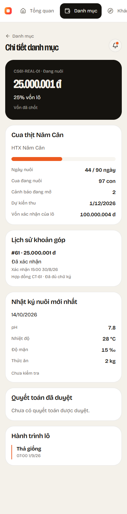

# CS-61 / KH-11 — Investor portfolio

Branch: `feature/CS-61-danh-muc-ndt`, from develop `ce5e422` (includes CS-50, CS-54, CS-57 and CS-20).

## Delivered behavior

- Investor-only list/detail APIs with current database access checks, no-store responses, filters/paging, global summary and actual operational metadata.
- Frozen amount/ratio from `v_investor_portfolio`; live confirmed contributions before freezing are provisional. Reserved, expired and refunded payments do not count toward positions. No synthesized rights after freezing; no yield/ROI fields.
- Detail returns only the current investor's contributions/contract metadata, latest received production log, actual milestones/Accepted-evidence timeline and published approved settlement amounts. No private file paths.
- Web overview and Danh mục use API with dedicated detail URLs. Mobile Tổng quan uses Dio, removes `MockInvestorRepository.myContributions` and opens a real private detail. Existing cards, typography, colors and spacing are preserved.
- Queries are account scoped; mobile cancels disposed reads and keeps batch selection by code. Error/empty states never fall back to sample holdings. Public exploration, settlement prototypes and notifications outside portfolio screens are separate tasks.
- No migration, new dependency, write endpoint or audit-chain change. TH-07 capital freezing remains owned by Funding; readers support the immutable shares when available.

## Automated checks

Backend tests compare live/frozen amounts with SQL and cover integer dong, six-decimal ratios, unknown denominators, foreign access, revoked roles, missing profiles, reserved-only/absent frozen shares, aggregate contributions, filtered pages with global totals, Vietnam closed cycle days, Growing/alert counts, own contract metadata and draft/approved settlements. Database tests use isolated LocalDB.

Browser tests cover real overview/detail URLs and Back, money, provisional/unknown ratios, filters/paging, network retry, empty/404, account changes, role guards and 390px layout. Mobile tests cover paginated Dio reads, detail navigation, gauge values, integer money, nullable values, actual payouts, empty/error/retry, narrow layouts, role guards and session cancellation.

Commands from repo root:

```powershell
dotnet test backend/CrabShare.sln -c Release --artifacts-path .artifacts/cs61
cd web
npm.cmd run build
npm.cmd run test:kyc
cd ../mobile
flutter analyze
flutter test
```

Final local verification: **487 API tests + 4 settlement tests**, **62 browser tests**
and **66 Flutter tests** passed. Backend Release and web production builds passed;
Flutter analysis found no issues. Package restore including NuGet vulnerability metadata succeeded.

The tested backend is running at `localhost:5233` (PID 21744 at validation time).
Real login and portfolio reads as `investor1@crabshare.local` returned 200 and a
correct empty portfolio: this older CrabShareDev contains only CS44-DEMO-01 and
no contributions or capital shares. No holdings were invented and no business
data was edited for this smoke test. Nonempty list/detail/view comparisons are
covered by the isolated SQL integration tests. New development databases seeded
by the current lifecycle seeder contain funded demo positions; existing databases
are intentionally not reset by that seeder.

## Manual test

1. Run the dev API with LocalDB and real confirmed contributions/capital shares (or a fresh development database seeded by the existing lifecycle seeder). The current older CrabShareDev has no holdings, so its empty state is expected. USB Android: `adb reverse tcp:5233 tcp:5233`, `API_URL=http://127.0.0.1:5233`. Web: `VITE_API_URL=http://localhost:5233`.
2. Sign in as Investor `investor1@crabshare.local`, dev password `CrabShare@2026`. Open Web → Tổng quan → Danh mục, or Mobile → Tổng quan. Switch batches and tap a contribution card.
3. Compare amount/ratio with the current investor's `v_investor_portfolio` rows. LiveConfirmed rows match own/all Confirmed contributions. Currency has no fractional dong; percentages mean capital ownership.
4. Check cycle, registry counts, alerts, own contract history and timeline. Null values show unavailable data. Approved settlement is labelled waiting for payout until actual PaidOut status.
5. Switch accounts, refresh and open a foreign detail URL. Old holdings disappear; foreign detail returns 404. Stop the API to verify retry/error UI.

Screenshots use controlled browser fixtures to verify layout, not production or local database evidence.



