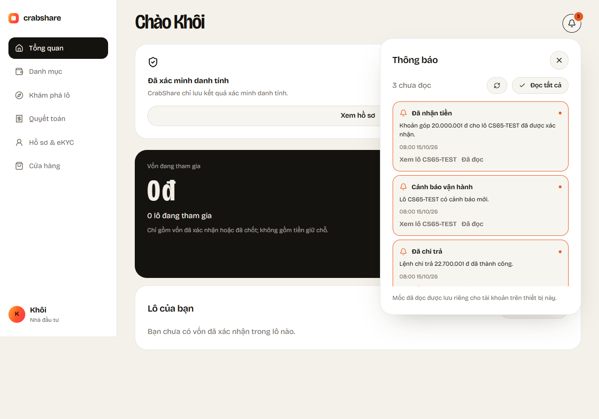
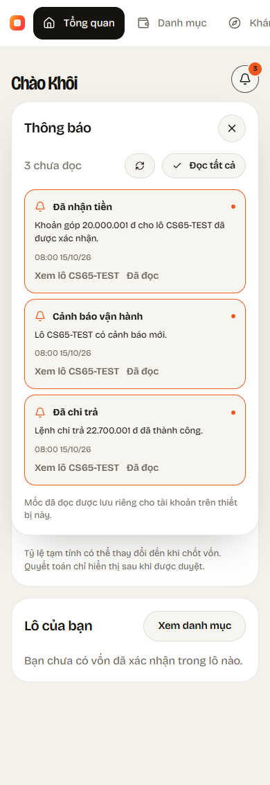

# CS-65 / KH-12 — In-app investor notifications

Branch `feature/CS-65-thong-bao`, created from develop `7627bbc` after CS-61 was merged.

## Behavior

The investor portal bell and mobile Notifications tab now read actual events instead of sample notifications. Opening the bell/tab does not mark everything as read. Users can mark one event, open its real portfolio detail, or explicitly read all fetched events. A badge shows the unread count on web, mobile home and the investor navigation tab.

Read state lives on the device, separately for each user ID: web localStorage and the existing Flutter secure-storage plugin. The marker uses the latest observed server event timestamp, IDs at that timestamp, and individually read IDs. It never uses the phone/browser clock, never moves backwards, and does not mark a new event with the same timestamp as already read. Failed writes preserve unread status and show an error. Changing accounts cancels pending requests and does not reuse another investor's feed/marker; pending writes keep their original user key.

Both clients refresh while open every 30 seconds and support explicit refresh/retry. Web also refreshes on window focus. No push/FCM integration or new package is required for the Jira acceptance criteria.

## API

`GET /api/me/notifications?after=&until=&page=1&pageSize=100`

- Requires an Investor JWT plus a current active database user, Investor role and profile. KYC verification is not required to read existing events.
- `after` is an optional **exclusive** timestamp; `until` is an optional **inclusive** timestamp. Invalid/future/inverted windows return 400. `pageSize` is 1–100.
- Returns `{items,page,pageSize,total,asOf}`. Clients fetch all pages with the first response's server `asOf` as `until`, so new events do not shift the time window. Sorting is timestamp descending, event type order, then source ID descending, including ties.
- Each item has stable `id`, `type`, `title`, `body`, `at`, `batchCode`, `canOpenPortfolio`, and nullable integer-VND `amount`. A historical receipt without current portfolio access has no clickable batch link.
- Reads run in a serializable transaction with SQL execution-strategy retries and no-store responses. No notification table, migration, audit write, external message or business-data write is added.

| Event | Source and scope |
|---|---|
| PaymentConfirmed | Own contribution with actual confirmation timestamp; Confirmed or subsequently Refunded. A historical receipt is not current capital. |
| ContractSigned | Own investment contract with an actual fully-signed timestamp; no private contract path. |
| ProductionReceived | Received production log for a batch currently accessible under CS-61 capital-share/live-confirmation rules. |
| AlertRaised | Actual raised alert for an accessible batch, including an alert that has since been resolved. Internal notes are not exposed. |
| SettlementPublished | Own settlement line with ProposedAt (or actual approval fallback), only in published Proposed/Disputed/Approved/PaidOut/Closed states. Draft amounts are never exposed. |
| PayoutSucceeded | Own settlement line, approved settlement, and an actual Succeeded Payout instruction with CompletedAt. Status Approved/PaidOut alone does not create an executed-transfer event. |

This is a feed derived from existing source rows, not a durable outbox. Deleting/changing source data may change its event representation. Repeated settlement revisions/history not retained by source tables cannot be reconstructed. No other investor identities, bank details, private file paths or projected return fields are returned.

## Validation

Backend tests cover receipt arrival after confirmation, six event sources, current-role revocation, own/foreign scoping, future-event filtering, Draft/Proposed/Approved publication rules, pending/failed payouts, stable tied-time paging, timestamp filters, exact money, private-data exclusion, cache headers and no audit writes. Integration fixtures use isolated LocalDB databases.

Browser tests cover receipt arrival on refresh, opening without automatic acknowledgment, persistence/reload, same-time arrivals, single reads and real detail URLs, all-page snapshots, empty/error/HTML responses, storage failures, account changes and 390px layout.

Mobile tests cover paginated Dio reads, exact VND, marker serialization and equal-time boundaries, actual navigation badges and private routes, persistence, network/storage retry, pending account changes and narrow layouts. Existing portfolio/KYC/smoke tests inject empty notification APIs and device stores.

Release backend: **562 API tests + 4 settlement tests passed**, including 20 notification-specific tests. Flutter analysis is clean and **all 75 tests passed**, including 9 notification tests. Web production build passed; **79 browser tests passed**, with two pre-existing real-API tests skipped because their isolated VI04/VI05 APIs were not configured. Eight notification tests also passed independently and desktop/phone screenshots were inspected. The existing role-redirect and batch-edit browser tests now wait for the relevant DOM/form state before asserting, preserving all original behavior checks.

The tested API is running at `localhost:5233` (PID 21744 at validation time). Actual investor1 login and notification/portfolio reads returned 200 with `Cache-Control: no-store,no-cache`. The empty feed matched zero confirmed receipt rows in CrabShareDev; no business data was changed for this smoke test. Nonempty events and confirmation transitions use isolated SQL fixtures.

Package restore reports existing NU1902/NU1903 audit warnings for transitive `System.Security.Cryptography.Pkcs` 9.0.11. CS-65 does not change package references or suppress these warnings.

## Manual test

1. Run the API and clients. Sign in as Investor, e.g. `investor1@crabshare.local` / dev password `CrabShare@2026`.
2. Confirm a real contribution through the existing payment simulator/webhook flow. Refresh the investor bell or mobile Notifications tab: **Đã nhận tiền** must show the confirmed amount and batch. A reserved/unpaid contribution must not create it.
3. Open and close the list; the count remains. Mark one/read all, restart/reload, and confirm the saved state persists only for that account on that device.
4. Open an event with current portfolio access; it must go to the API-backed CS-61 detail. Historical receipts without access have no broken detail link.
5. Switch investors and verify isolation. Stop the API to check retry UI. A settlement awaiting payment must never say **Đã chi trả**.

The older local CrabShareDev previously contained only CS44-DEMO-01 and no investor contributions; an empty feed there is expected until a contribution is confirmed. Do not reset that database to test this feature.

Screenshots use controlled browser fixtures to verify the existing design, not production data:

