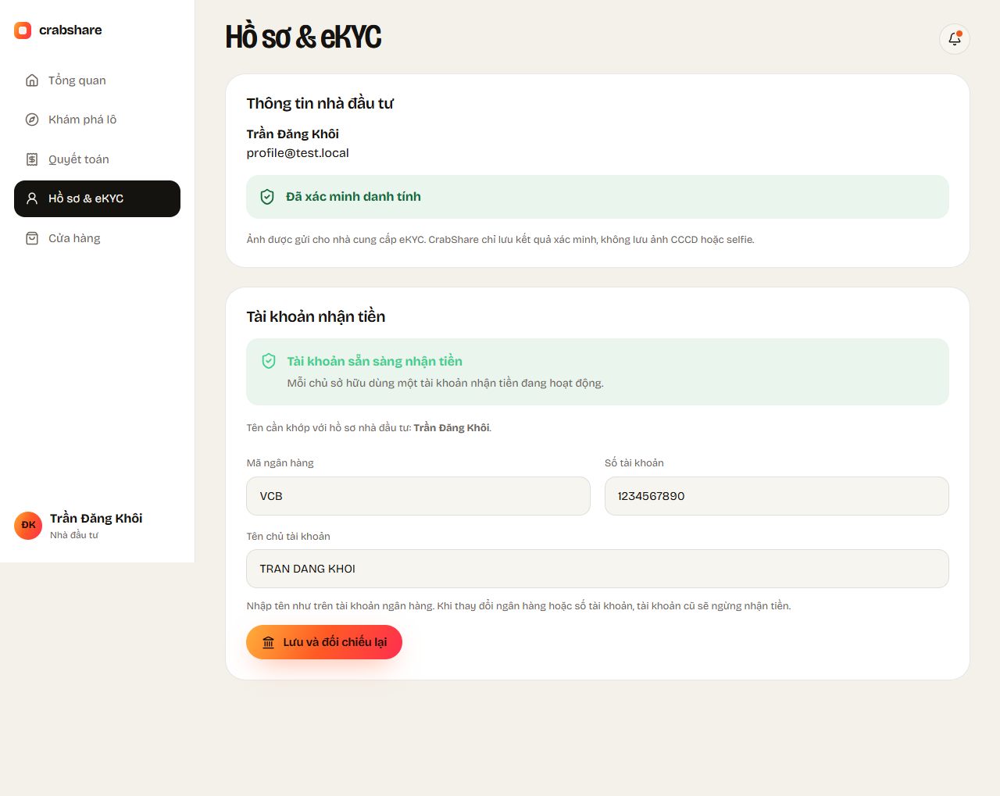
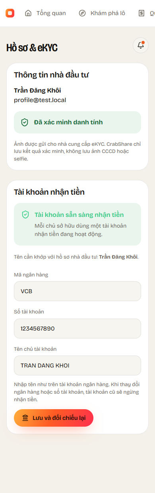
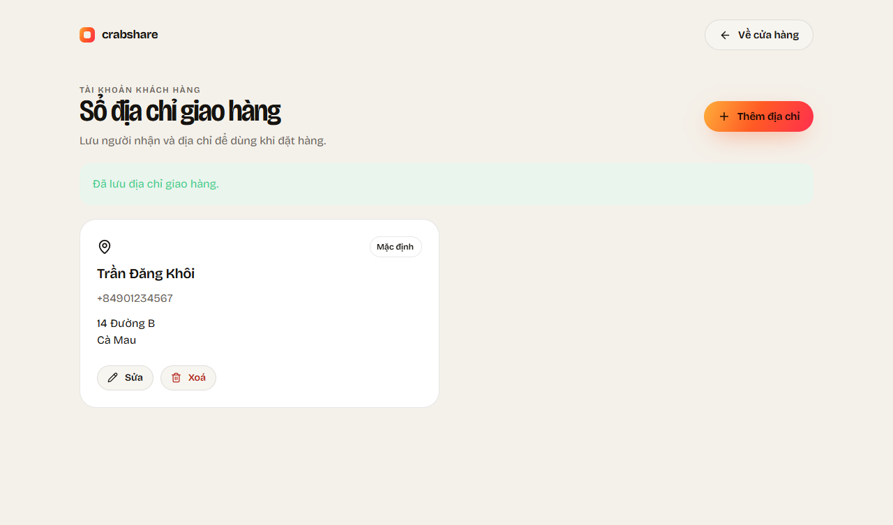
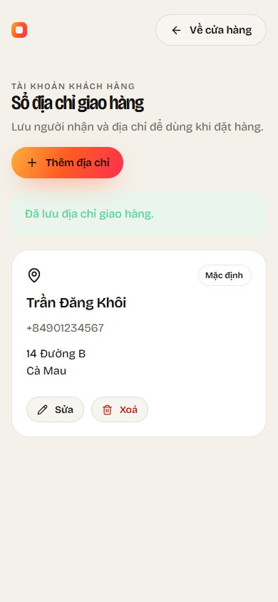

# KH-03 — Tài khoản nhận tiền và sổ địa chỉ giao hàng

Nhánh: `feature/KH-03-payout-addresses`, tạo từ develop.

## Cách dùng

- Backend mới chạy cổng 5233; đã áp V003 và V004 vào CrabShareDev bằng migrator,
  không reset hoặc xoá dữ liệu dev. V004 chặn hai tài khoản Active cùng chủ.
- Web nhà đầu tư: Hồ sơ & eKYC → Tài khoản nhận tiền.
- Web chủ hộ nuôi: menu Thu hoạch & tiền → Tài khoản nhận tiền, đường dẫn
  `/operator/payout-account`. Staff nhận thông báo không có quyền.
- Web khách hàng: Cửa hàng → Sổ địa chỉ, đường dẫn `/tai-khoan/dia-chi`.
- Mobile: Tài khoản → Tài khoản nhận tiền. Nếu có hai vai, chọn Cá nhân hoặc Hộ nuôi.
- Ngân hàng/số tài khoản thay đổi sẽ đóng tài khoản cũ. Đối chiếu tên hiện giả lập:
  nhập đúng tên hồ sơ (Investor) hoặc tên pháp lý hộ nuôi (Operator), có thể bỏ dấu.
  Không khớp tên → Locked; sửa và lưu lại để đối chiếu.

## Kiểm tra local

| Kiểm tra | Kết quả |
|---|---|
| `dotnet test backend/CrabShare.sln --no-restore` | 113 đạt (109 API + 4 Settlement) |
| BankNameMatch | Khớp tên → Active + Passed; không khớp → Locked + Failed, sửa được; eKYC giữ nguyên |
| Phân quyền | Staff/khác vai/người dùng bị khoá bị từ chối; không thể bỏ qua khoá ngân hàng đã Matched |
| Đồng thời | Hai lần PUT cùng chủ chỉ còn 1 Active; hai lần thêm mặc định giữ đủ 2 địa chỉ và 1 mặc định |
| Địa chỉ | CRUD + Location/201/204; id của khách khác trả 404; đổi/xoá mặc định đúng |
| Web build | Đạt |
| Playwright | 9 đạt (3 eKYC + 6 tài khoản/địa chỉ), API mock |
| Flutter analyze | Không issue |
| Flutter test | 38 đạt; 4 test tài khoản nhận tiền + smoke màn mới |
| Android APK debug | Build thành công: `mobile/build/app/outputs/flutter-apk/app-debug.apk`; API_URL localhost:5233 (USB dùng adb reverse) |

DB test dùng CSDL LocalDB riêng và xoá sau khi chạy, không thay dữ liệu dev.
Ảnh giao diện dùng tên/số tài khoản/địa chỉ mẫu từ test. Đã xem ở desktop và 390px.
Chưa chạy thử trực tiếp màn mới trên điện thoại thật trong lượt này.

## Giao diện

