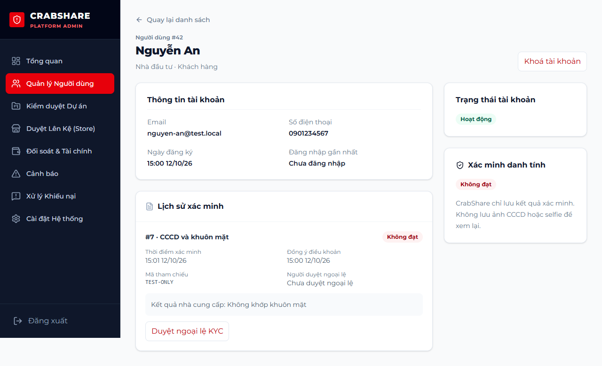
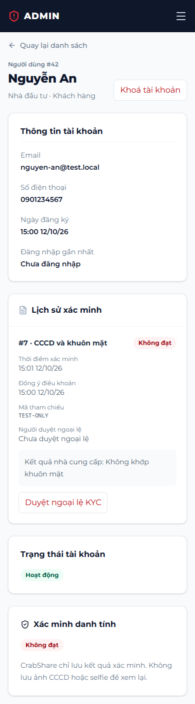
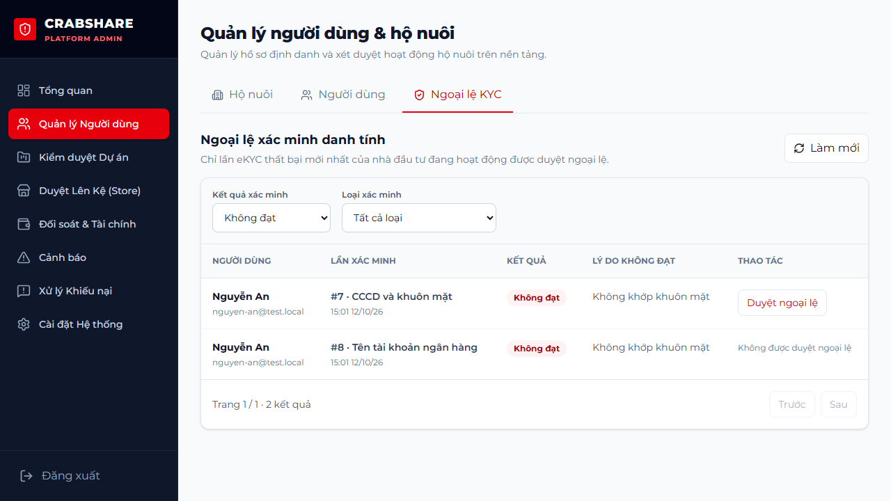

# KH-04 — Ngoại lệ KYC và quản lý người dùng

Nhánh `feature/KH-04-kyc-user-management`, tạo từ develop.

## Kết quả

- API quản trị: danh sách người dùng có lọc vai/trạng thái/tìm tên-email-điện thoại-ID,
  phân trang; chi tiết tài khoản và lịch sử KYC; khoá/mở khoá với lý do.
- Hàng đợi KYC có lọc kết quả/loại và phân trang. Duyệt ngoại lệ chỉ cho lần
  EkycIdFace Failed mới nhất, có consent, của nhà đầu tư Active chưa Verified.
  Không duyệt BankNameMatch để biến thành Verified. Không tự duyệt danh tính.
- Duyệt → ExceptionApproved + reviewed_by; nhà đầu tư Verified + verified_at.
  Giữ thời điểm kiểm tra, mã tham chiếu và lý do không đạt của nhà cung cấp.
- Tất cả thay đổi cùng audit trong transaction; cập nhật đồng thời không duyệt hai lần.
  Audit có người quyết định và lý do, không chứa mật khẩu, ảnh hoặc số CCCD.
- Đăng nhập Locked trả 403 auth.locked. JWT đã cấp cũng bị từ chối (401);
  client có sẵn xử lý đăng xuất khi gặp 401. Quyền admin hiện tại kiểm tra từ DB.
- Không khoá chính admin đang thao tác. Mở khoá khôi phục PendingVerification
  nếu có audit lần khoá trước; bản Locked từ trước khi có audit khôi phục Active.
- Web giữ AdminLayout/sidebar tối, nút đỏ, card/bảng/filter/chip/modal của trang
  quản trị đang có. Thay dữ liệu mẫu, bỏ khung CCCD/độ chính xác mock.
  Quản trị → Quản lý Người dùng → Người dùng / Ngoại lệ KYC.
- Trang chi tiết dùng `/admin/users/detail?id=<id số>`. EvidenceReviewer không được
  mở các trang quản trị tài khoản; backend cũng chỉ nhận PlatformAdmin.
- Mobile không có màn mới trong KH-04. Không cần migration hoặc thay entity.

## Kiểm tra

Kết quả local: **116 test backend đạt** (112 API + 4 Settlement); **10 browser test
đạt**; web production build đạt.

Backend test dùng CSDL LocalDB riêng, không sửa tài khoản demo/dev. Browser test
dùng API mock và dữ liệu mẫu; ảnh chụp chỉ chứa dữ liệu mẫu của bộ test.

- Backend: phân quyền/validation, lọc/phân trang/trang rất lớn, metadata không có mật khẩu;
  đăng nhập 403 auth.locked, JWT cũ 401, mở khoá; quyền admin bị thu hồi; tự khoá/tự duyệt;
  ngoại lệ đạt, bank check/lần cũ/Passed/Locked bị từ chối; audit/hash và rollback;
  hai request duyệt đồng thời chỉ có một lần thành công.
- Web: 10 browser test đạt (7 quản trị + 3 eKYC), gồm lọc/phân trang, lý do bắt buộc,
  khoá/mở khoá, Verified sau duyệt, lỗi 422/404, reviewer không gọi API quản trị.
- Web build đạt; đã xem ảnh desktop và 390px, giao diện chi tiết không tràn.

