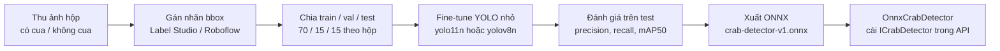

# ML — Nhận diện cua trong ảnh hộp (TSK-13)

**Người làm:** Nhân · **Jira:** [CS-23](https://nguyendaothien2003.atlassian.net/browse/CS-23) → [CS-49](https://nguyendaothien2003.atlassian.net/browse/CS-49) → [CS-79](https://nguyendaothien2003.atlassian.net/browse/CS-79) · **Tích hợp với:** Khôi (module Evidence)

Mục tiêu (Phiếu): mô hình phát hiện vật thể đã huấn luyện sẵn (YOLO) **fine-tune** trên ảnh hộp nuôi, trả lời "trong ảnh có cua không".
Đạt **precision ≥ 0,85** và **recall ≥ 0,80** trên tập kiểm tra giữ riêng; chưa đạt thì chỉ dùng như tín hiệu yếu trong `risk_score`.
Ngoài phạm vi: phát hiện cua lột / cua chết, ước lượng kích thước, đọc mã hộp/QR, phát hiện ảnh giả (deepfake).

Ảnh thật/giả trong production do Evidence xử lý (camera-only, GPS, SHA-256, perceptual hash, capture request) — không thuộc YOLO.

## Quy trình



## Thư mục

```
ml/
├── README.md
├── data.yaml                      ← lớp: 0 = crab
├── notes/capture_log.example.csv  ← mẫu nhật ký buổi chụp
├── scripts/prepare_dataset.py     ← kiểm tra nhãn + chia theo hộp
├── scripts/test_prepare_dataset.py
├── train.ipynb                    ← CS-49: huấn luyện (Colab GPU)
├── evaluate.ipynb                 ← CS-49: đánh giá + xuất báo cáo
└── report/                        ← kết quả lần train (không commit ảnh nặng)
```

Ảnh và file mô hình **không commit** vào git: Google Drive nhóm; `.onnx` lên GitHub Releases rồi copy vào `backend/.../models/` khi chạy API.

### Drive nhóm (gợi ý)

```
CrabShare-ML/
  raw/                 # ảnh gốc theo phiên chụp
  labeled/             # export YOLO từ Roboflow / Label Studio
  splits/              # bản sao ml/datasets/crab nếu cần
  notes/capture_log.csv
  NGUON_ANH.md         # nguồn + đồng ý dùng ảnh
```

## Protocol chụp (CS-23) — trại ~50 hộp → ≥300 ảnh

**Thiết bị:** camera điện thoại thường, JPEG ≥ 720p. Không bắt buộc app CrabShare lúc thu dataset.

**Công thức:** 300 ảnh ≠ 300 hộp.

| Loại | Mục tiêu | Cách lấy |
|---|---|---|
| Có cua | ~220 | 50 hộp × **4–5 góc/hộp** (thẳng, nghiêng trái/phải, gần hơn) |
| Không cua | ~80 | Hộp trống / nắp đóng tại trại + mô phỏng ngoài trại (`source=sim`) |

**Luôn làm**

- Chụp từ trên xuống, hộp ≥ 70% khung hình
- Đổi góc thật sự — không chụp 5 frame gần như trùng
- Số hộp trại (nếu có) nên vào khung; **không cần** mã lô/QR CrabShare để train
- Ghi `notes/capture_log.csv` mỗi phiên

**Tránh:** screenshot, ảnh Google, crop/xoay cùng một file rồi đếm là ảnh mới, khuôn mặt rõ (blur nếu lọt).

### Đặt tên file

```
<nguồn>_<YYYYMMDD>_<số hộp>_<stt>.jpg
iot_20261022_B017_003.jpg
self_20261022_A-02-05_001.jpg
sim_20261023_NA_001.jpg          # mô phỏng / không có số hộp → mỗi file một nhóm
```

`nguồn`: `iot` (trại), `self` (nhóm tự chụp tại trại/lab), `sim` (mô phỏng), `pub` (công khai — hộp `NA`).

### Quy ước gán nhãn

Một lớp `crab` (id 0), bounding box.

| Trường hợp | Gán nhãn |
|---|---|
| Cua rõ / che một phần nhưng còn nhận ra | `crab`, khung ôm phần nhìn thấy |
| Cua chết | `crab` (phân biệt sống/chết ngoài phạm vi) |
| Chỉ vỏ lột / hộp trống / chỉ thức ăn | **không box** — ảnh âm |
| Không chắc | bỏ ảnh khỏi bộ dữ liệu |

Ảnh âm vẫn phải có file nhãn rỗng hoặc *Mark Null* trên Roboflow. Script bỏ qua ảnh không có file nhãn.

### Chia tập

Sau khi export YOLO (Auto-Orient bật, Resize tắt, không Augmentation):

```bash
python ml/scripts/prepare_dataset.py ml/datasets/raw --check-only
python ml/scripts/prepare_dataset.py ml/datasets/raw
python -m unittest ml/scripts/test_prepare_dataset.py
```

Chia **theo số hộp** (70/15/15) để cùng một hộp không nằm cả train lẫn test. Chi tiết trong `split_manifest.csv`.

## Huấn luyện và đánh giá (CS-49)

1. Mở `ml/train.ipynb` trên Google Colab (GPU), gắn Drive, chỉnh `DATA_YAML`.
2. Fine-tune `yolo11n.pt` hoặc `yolov8n.pt`, 50–100 epoch.
3. Chạy `ml/evaluate.ipynb` trên tập test giữ riêng → ghi `ml/report/`.
4. Xuất `crab-detector-v1.onnx` (ô cuối `train.ipynb` hoặc `evaluate.ipynb`).

## Tích hợp API (CS-79)

1. Package `Microsoft.ML.OnnxRuntime` đã thêm vào `CrabShare.Api`.
2. `Infrastructure/Detection/OnnxCrabDetector.cs` cài `ICrabDetector`.
3. Cấu hình `CrabDetector:ModelPath` trong `appsettings.json` (mặc định `models/crab-detector-v1.onnx`).
4. Thiếu file `.onnx` → detector trả `model_version=none` (giống Noop), API vẫn chạy.
5. Evidence lưu kết quả vào `evidence_detection`.
