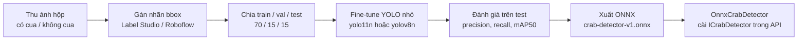

# ML — Nhận diện cua trong ảnh hộp (TSK-13)

**Người làm:** Nhân · **Tích hợp với:** Khôi (module Evidence)

Mục tiêu (Phiếu): mô hình phát hiện vật thể đã huấn luyện sẵn (YOLO) **fine-tune** trên ảnh hộp nuôi, trả lời "trong ảnh có cua không".
Đạt **precision ≥ 0,85** và **recall ≥ 0,80** trên tập kiểm tra giữ riêng; chưa đạt thì chỉ dùng như tín hiệu yếu trong `risk_score`.
Ngoài phạm vi: phát hiện cua lột / cua chết, ước lượng kích thước.

## Quy trình



## Thư mục (tạo khi làm)

```
ml/
├── README.md
├── data.yaml            ← khai báo lớp: 0 = crab
├── train.ipynb          ← notebook huấn luyện (chạy Google Colab GPU miễn phí)
├── evaluate.ipynb       ← tính precision / recall trên tập test, xuất báo cáo
└── report/              ← bảng kết quả + ảnh minh hoạ cho báo cáo
```

Ảnh và file mô hình **không commit** vào git (nặng): để trong Google Drive của nhóm; file `.onnx` đưa lên mục *Releases* của GitHub.

## Tích hợp vào API

1. Thêm package `Microsoft.ML.OnnxRuntime` vào `CrabShare.Api`.
2. Viết `Infrastructure/Detection/OnnxCrabDetector.cs` cài `ICrabDetector.DetectAsync(Stream image, ...)`:
   resize 640×640 → chạy mô hình → lấy box có confidence cao nhất → trả `CrabDetectionResult(crabDetected, confidence, "crab-detector-v1")`.
3. Đổi đăng ký trong `Infrastructure/DependencyInjection.cs` từ `NoopCrabDetector` sang `OnnxCrabDetector` (đường dẫn mô hình trong `appsettings.json`).
4. Module Evidence lưu kết quả vào `evidence_detection` (kèm `model_version`).
